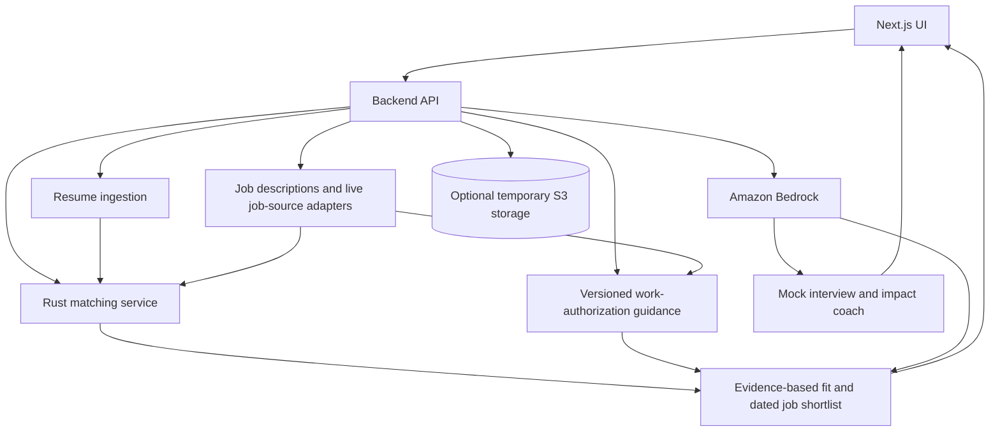

# ScaleMe — Expanded Product Vision

**Your AI career growth engine, built for domestic and international job seekers.**  
*From overlooked applicant to interview-ready candidate—with clearer guidance on which opportunities are worth pursuing.*

> **Status:** SunHacks 2026 hackathon MVP in development. This is an expanded roadmap that preserves the original vision and adds international-student support and job discovery. Features described here are proposed, not necessarily implemented. The original [README.md](./README.md) is preserved separately.

## The problem

Job seekers often have valuable experience that their resumes fail to communicate. Keyword-based resume checkers may flag missing terms, but they rarely uncover *what changed because of the candidate's work* or help the candidate explain it under interview pressure.

International students face an additional challenge: even a technically excellent match may be impractical if the job's timing, work schedule, work authorization expectations, or stated citizenship requirements do not align with the student's circumstances. Job postings are often unclear about sponsorship, CPT, OPT, and STEM OPT.

Meanwhile, job openings are scattered across employer career pages and boards. Students need a way to find **real, current jobs for a specific period**, understand why a posting matches their experience, and identify questions to verify before applying.

## The ScaleMe experience

1. **Upload a resume** (PDF) or select a safe demo sample.
2. **Choose a target role** by pasting a job description, entering a posting URL, or selecting an opening found by ScaleMe.
3. **Set career and search preferences**: skills, location, remote/hybrid preference, internship versus full-time, part-time versus full-time, and desired employment dates or semester.
4. **Optionally add work-authorization context**: for example, whether the candidate is an F-1 student considering CPT, OPT, or a STEM OPT extension. This is an optional assistance feature, not a legal determination.
5. **Discover suitable openings** for the requested period, with source links, posting dates when available, and clearly labeled work-authorization signals.
6. **Understand the resume-to-role fit** with transparent, evidence-backed matches, gaps, and questions—not a fabricated probability of being hired.
7. **Practice a text-based AI interview** with increasingly specific follow-up questions based on the resume and the role.
8. **Turn real answers into impact**: stronger, accurate resume bullets, interview talking points, and a concrete improvement plan.
9. **Build an application shortlist** with job links, eligibility questions to clarify, and next steps.

### What makes ScaleMe different?

**ScaleMe discovers missing context through conversation.** A bullet such as “Built an internal tool” triggers questions about users, constraints, technical choices, adoption, and measurable outcomes. It proposes stronger wording only from facts the candidate actually supplies.

**ScaleMe combines skill fit, job timing, and authorization awareness.** A candidate may have the right skills but need to verify employment dates, CPT approval, an employer's sponsorship policy, or a genuine citizenship restriction. ScaleMe explains these separately instead of pretending to make a definitive eligibility decision.

## Core feature 1 — Evidence-based resume and role analysis

- Parse PDF resume text and accept job descriptions pasted as text.
- Support a job-posting URL when retrieval is allowed; offer a paste fallback.
- Extract skills, relevant projects, experience, responsibilities, and job requirements.
- Show evidence for matches, missing information, and potential gaps.
- Ask questions before adding metrics or accomplishments; **never fabricate claims**.
- Explain results as coaching guidance rather than a hiring prediction.
- Generate interview topics and prioritized learning or application actions.

## Core feature 2 — AI mock interview and impact coach

- Conduct an interactive, text-first mock interview grounded in the resume and chosen job.
- Start with role-specific questions, then ask deeper follow-ups about decisions, tradeoffs, outcomes, and technical knowledge.
- Keep interview claims traceable to resume text or user-provided answers.
- Give constructive feedback on specificity and clarity.
- Produce factual resume bullet suggestions, talking points, and a next-step plan.
- **Stretch:** voice interviewing, saved history, and progress visualization.

## Core feature 3 — International student career support (new)

ScaleMe should be useful to international students applying for U.S. jobs without pretending to be an immigration lawyer, a university DSO, or an employer's HR department.

### Optional candidate profile

Ask only for information relevant to the search, and let the candidate skip any field:

- Current work-authorization category, if the user wants to share it (for example F-1 student).
- Intended work pathway (CPT, pre-completion OPT, post-completion OPT, STEM OPT, or unsure).
- Graduation timing and expected employment start/end dates.
- Academic term, major/field of study, and internship or job type.
- Desired weekly hours and part-time/full-time preferences.
- Whether future employer sponsorship may be needed; do not infer this from nationality.

Do **not** require passport numbers, SEVIS numbers, immigration documents, nationality, or exact birth dates to provide career coaching. Do not upload these documents to AI services as part of the MVP.

### Authorization-aware guidance

Use a maintained, cited rules/knowledge layer to present **general information**, with dates and links to primary official sources. Key distinctions include:

- **CPT:** Curriculum-linked practical training authorized by the student's designated school official (DSO). Approval is employer-, location-, and date-specific; the student must have proper authorization before starting. University policies and student circumstances matter. Twelve months or more of full-time CPT can affect post-completion OPT eligibility.
- **OPT:** F-1 practical training related to the student's major. The student generally needs the applicable USCIS employment authorization and must follow its approved dates and conditions. Pre-completion and post-completion OPT differ.
- **STEM OPT extension:** Additional conditions can include qualifying degree/program criteria, the employer's E-Verify participation, a training plan, and other USCIS requirements.
- **Future sponsorship:** Whether a company sponsors a future employment status is a separate question from whether the candidate can work under CPT or OPT now.
- **Citizenship and export-control statements:** “U.S. citizen required,” “U.S. person,” “security clearance required,” and “no sponsorship” are **not interchangeable**. Some positions have lawful restrictions, but a general ITAR/EAR reference does not automatically mean U.S. citizenship is required.

Because rules, policy, school practices, and individual circumstances vary, **never guarantee CPT/OPT eligibility, work authorization, or employer acceptance**. Encourage verification with the university's DSO, the employer, and qualified counsel when appropriate.

### Job eligibility signals—not legal verdicts

Each suggested job can show:

| Signal | Meaning |
| --- | --- |
| Work authorization | Listing's explicit language, quoted or paraphrased with source |
| Citizenship | Whether the posting explicitly states a citizenship requirement |
| Sponsorship | Confirmed policy if stated; otherwise **Unknown** |
| CPT/OPT compatibility | Possible, requires verification, or explicit mismatch based on available evidence |
| STEM OPT considerations | E-Verify/training requirements to verify, not assumptions |
| Timing and weekly hours | Job dates and schedule compared with user preferences |
| Confidence and evidence | Which source supports each finding, and when it was checked |

**Important:** An unknown policy must be displayed as **Unknown**, not “ineligible.” Avoid hard-filtering a job solely on inferred immigration status. Allow the user to see the posting and the reason for any warning. Do not assume an employer's sponsorship stance from its industry or previous hires.

**Example (illustrative, not a live job):** A student seeking a Spring part-time internship sees a software engineering role. ScaleMe identifies skill matches, notices that the listing does not specify sponsorship, and flags “CPT authorization and employer policy require confirmation,” rather than promising eligibility or rejecting the opportunity.

## Core feature 4 — Smart job discovery by period (new)

Users should be able to ask:

- “Find 5 software engineering internships for Summer 2027.”
- “Show part-time development internships for Spring 2027 in the Phoenix area.”
- “Find remote entry-level data roles starting after graduation.”
- “Find internships where the listing does not explicitly require U.S. citizenship, and label sponsorship information if it is available.”

### Search filters

- Target role or keywords and required skills.
- Location, radius, remote/hybrid/on-site.
- Internship, entry-level, new graduate, part-time, or full-time.
- **Desired work period:** semester/season (Spring, Summer, Fall), specific start/end dates, or flexible window.
- Minimum/maximum weekly hours where known.
- Compensation when available.
- Optional authorization-related constraints and transparency settings.
- Number of openings to return (for example, a shortlist of 5–10).

**A desired work period is not the same as a posting date.** The system must distinguish the job's application deadline, posting date, expected start date, internship duration, and user's preferred period. Never infer a start date solely from when the listing was posted.

### Job ingestion and matching

1. Use permitted job APIs, ATS feeds, and company career pages where feasible; respect robots rules, terms, rate limits, and attribution.
2. Ingest the title, employer, location, employment type, source URL, description, posting date, deadline and work dates (when actually present).
3. Normalize and deduplicate listings, and identify expired or inaccessible postings.
4. Extract explicit skills, schedule, citizenship, work-authorization, and sponsorship language; retain source excerpts or links.
5. Compare the posting with candidate skills, desired dates, preferences, and optional authorization context.
6. Rank results with **explainable scores or match factors**, separating skill fit, date fit, location fit, and unknown eligibility questions.
7. Display a limited list of **real openings** with clickable original application links and a **last checked** timestamp.
8. Let the candidate save a shortlist and select an opening for resume analysis and mock interview.

**Freshness rule:** Do not invent companies, openings, application URLs, deadlines, sponsorship policies, or job dates. Mark missing data as unknown. If live job retrieval is unavailable, show a conspicuously labeled demo dataset and do not describe it as current jobs.

### Example job card (fictional)

> **Software Engineering Intern — Example Company (DEMO)**  
> Location: Phoenix, AZ · Desired period: Summer 2027  
> Skill fit: Python ✓ · SQL ✓ · AWS: not demonstrated  
> Dates: Not confirmed · Citizenship: Not specified · Sponsorship: Unknown  
> International-student note: Ask the employer about work authorization requirements; confirm CPT with your DSO if applicable.  
> Source: Demo sample, **not an active opening**.

## Hackathon MVP — what we must actually ship

The minimum convincing story should be end-to-end and easy to demo to judges.

### Priority 0: Core working journey

- [ ] Responsive Next.js interface with a complete happy path.
- [ ] PDF upload, text extraction, file validation, and useful errors.
- [ ] Job description pasted as text; URL ingestion only when feasible.
- [ ] Evidence-backed resume-to-job analysis and explainable match output.
- [ ] Interactive **text-based** AI mock interview with follow-up questions.
- [ ] Fact-grounded impact bullets and an actionable improvement plan.
- [ ] Working AWS-backed AI path (Amazon Bedrock).
- [ ] Meaningful, testable Rust matching component.
- [ ] Sample inputs, short demo script, and submission documentation.

### Priority 1: New features for a stronger demo

- [ ] Optional “International student / work authorization guidance” UI.
- [ ] Clear detection of job-posting phrases like “U.S. citizenship required,” “no sponsorship,” and unknown sponsorship status, backed by text evidence.
- [ ] CPT/OPT/STEM OPT general-information help with primary-source links and a visible non-legal-advice disclaimer.
- [ ] Job discovery view with role, location, internship type, and **desired semester/date range**.
- [ ] A small shortlist of genuine job postings **if a compliant live source is available**, including original URLs, timestamps, and unknown-field labels.
- [ ] A clearly labeled demo dataset if external job retrieval cannot be completed in time.
- [ ] “Analyze this job” action connecting discovery to the original resume analysis and interview experience.

### Stretch goals / post-hackathon roadmap

- [ ] Robust multi-source job aggregation, automatic freshness checks, and expired-posting cleanup.
- [ ] Saved searches, application tracking, and optional notifications for new openings matching a future semester.
- [ ] Employer sponsorship-policy verification where public evidence is available.
- [ ] More nuanced CPT/OPT/STEM OPT knowledge base with change monitoring and versioned official sources.
- [ ] User accounts, profiles, historical interview feedback, and progress dashboards.
- [ ] Voice interviewing.
- [ ] Employer/company research (possibly TinyFish if a genuine permitted integration is shipped).
- [ ] Advanced matching recommendations and personalized learning plans.

## Proposed technical architecture

| Layer | Proposed technology | Responsibility |
| --- | --- | --- |
| Web | Next.js App Router, TypeScript, Tailwind CSS | Upload, job discovery, profiles, analysis, interview, shortlist |
| AI | Amazon Bedrock | Structured analysis, interview coaching, impact suggestions, extraction with evidence |
| Cloud | Amazon S3, AWS Lambda, API Gateway | Temporary storage and backend APIs where practical |
| Matching | Rust | Deterministic skill, requirement, and timing comparison with explainable signals |
| Jobs | Licensed/permitted job APIs, ATS feeds, employer pages | Retrieve and normalize verifiable postings |
| Guidance | Versioned official-source reference data + conservative rules | CPT/OPT information and eligibility *questions*, not immigration decisions |
| Development | Cursor, Claude, Grok, ChatGPT | Parallel implementation, debugging, and review |

All selections are proposed and may be simplified to keep the demo reliable.



### Suggested repository layout (not necessarily created)

```text
ScaleMe/
├── web/                    # Next.js dashboard and user flows
├── services/
│   ├── api/                # Backend orchestration and AI endpoints
│   ├── matching-rust/      # Explainable skill/timing matching
│   ├── job-sources/        # Job provider adapters and deduplication
│   └── guidance/           # Versioned public information and rules
├── docs/                   # API contracts, security, demo, architecture
├── README.md               # Original hackathon vision (unchanged)
└── README-expanded.md      # Expanded vision and roadmap
```

## Data and API contracts (proposed)

Agree on types before parallel implementation. A normalized job record should distinguish *missing* fields from negative findings.

```ts
type JobOpening = {
  id: string;
  title: string;
  company: string;
  location?: string;
  employmentType?: "internship" | "part_time" | "full_time" | "contract" | "unknown";
  sourceUrl: string;
  postedAt?: string;          // only if source provides it
  applicationDeadline?: string;
  workStartDate?: string;     // only if verified
  workEndDate?: string;
  lastCheckedAt: string;
  citizenshipRequirement?: "explicitly_required" | "not_stated" | "other_stated";
  sponsorshipStatement?: "available" | "not_available" | "not_stated";
  evidence: Array<{ field: string; text: string; sourceUrl: string }>;
};
```

Do not store a computed “legally eligible: yes/no” field. Prefer explainable warnings, missing-information flags, and user-verifiable next steps.

## Workstreams and collaboration

GitHub Issues are the source of truth. Claim an issue before implementing. Use branches `feat/<short-name>` and `fix/<short-name>`, small pull requests, and acceptance criteria. **Do not let multiple AI agents edit the same files or branch simultaneously.**

Suggested lanes:

- **Web/UI:** dashboard, resume upload, job filters, results, interview chat.
- **AI/backend:** structured prompts, evidence schemas, Bedrock integration, API handlers.
- **Rust/matching:** deterministic skills and scheduling match logic with tests.
- **Jobs/guidance:** permitted job ingestion, timestamps, authorization-language extraction, official citations.
- **Integration/demo:** end-to-end QA, privacy/security checks, deployment, demo script.

Keep response shapes agreed on before parallel work. Never commit secrets or personal applicant information.

## Responsible AI, safety, and privacy

- Cite resume text, interview answers, and job descriptions for specific claims.
- Never invent experience, impact metrics, job openings, dates, sponsorship policies, or legal conclusions.
- Treat resumes, scraped job descriptions, and URLs as **untrusted data**, not instructions to the AI; protect against prompt injection.
- Limit file sizes/types; validate URLs and avoid server-side request forgery.
- Minimize personal data storage, logging, and retention; use consent, access controls, and deletion mechanisms if profiles are added.
- Use managed secret storage or local environment files; never commit AWS/API credentials.
- Show source evidence, confidence limitations, and a last-checked timestamp for job listings.
- Provide **general educational guidance only**, not legal advice or authorization approval. Direct the user to their DSO, employer, USCIS, or a qualified immigration professional for individual decisions.
- Avoid unlawful citizenship-status assumptions, discriminatory exclusion rules, or unexplained hard filtering.
- When live integrations fail, show a clearly labeled demo state instead of pretending external data is live.

## Official references for the guidance layer

Check these primary sources regularly because requirements can change:

- [DHS Study in the States — Practical Training](https://studyinthestates.dhs.gov/students/work/working-in-the-united-states)
- [USCIS — Optional Practical Training (OPT) for F-1 Students](https://www.uscis.gov/working-in-the-united-states/students-and-exchange-visitors/optional-practical-training-opt-for-f-1-students)
- [USCIS — STEM OPT Extension](https://www.uscis.gov/working-in-the-united-states/students-and-exchange-visitors/students-and-employment/stem-opt)
- [DOJ — Citizenship Status and Hiring FAQs](https://www.justice.gov/crt/iers-frequently-asked-questions-faqs)
- [DOJ — Export Controls and Immigration-Related Discrimination](https://www.justice.gov/crt/media/1287536)

These links are references for a guidance feature; they are **not** evidence that a particular job permits CPT, OPT, or sponsorship.

## Getting started

The project scaffold and local setup commands are still pending. Plan for Node.js (Next.js), Rust/Cargo, and AWS credentials if cloud components are enabled. Add an `.env.example` with variable names and no secrets. Use GitHub Issues to track implementation.

## Demo story

**Before:** A student has a resume that undersells real projects and cannot easily identify internships matching their dates or clarify work-authorization questions.  
**During:** ScaleMe finds or accepts a relevant opening, transparently shows skill and timing fit, flags only substantiated authorization concerns, and interviews the student about genuine experience.  
**After:** The student receives accurate stronger resume bullets, interview talking points, a shortlist of relevant openings, and questions to verify with employers or their DSO.

**SunHacks 2026:** November 14–15, 2026. Expo format from the project briefing: **3-minute demo + 2-minute judge Q&A**. Prefer a working end-to-end demonstration over slides.

**Potential award tracks:** Future of Work (JFF Ventures), Best Use of AWS (Amazon), and possibly TinyFish if a genuine integration is developed. Verify current eligibility and submission requirements before presenting claims.

**Repository:** [charlierichards13/ScaleMe](https://github.com/charlierichards13/ScaleMe)

---

**ScaleMe helps people tell the truth about their experience, tell it better, and find opportunities they can realistically pursue.**
