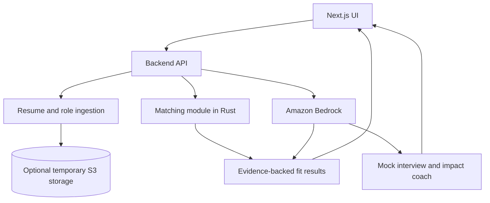

# ScaleMe

**Your AI career growth engine.**  
*From overlooked applicant to interview-ready candidate.*

ScaleMe is an AI-powered career preparation platform built at **SunHacks 2026**. Instead of only checking whether a resume matches a job description, ScaleMe helps candidates **understand their strengths, uncover the real impact of their experience, and practice explaining that impact under interview pressure**.

> **Status:** Hackathon MVP in development. The architecture and features below are plans, not claims that they are already implemented.

## The problem

Job seekers often have useful experiences that their resumes fail to communicate. Generic keyword checkers may point out missing terms, but they rarely ask *what actually changed because of your work* or help you practice defending your claims in an interview.

## The ScaleMe experience

1. **Upload your resume** (PDF) or use a demo sample.
2. **Add a target job** by pasting the description or a job-posting URL (with a text fallback if the page cannot be fetched).
3. **Understand your fit** through a transparent, evidence-based breakdown of matched experience, potential gaps, and areas worth clarifying—not a fabricated hiring probability.
4. **Get interviewed** by an AI coach that asks increasingly specific follow-up questions based on your own resume and the target role.
5. **Translate your answers into impact**: stronger, factual resume bullets, relevant interview talking points, and concrete next steps.

### What makes it different?

**ScaleMe discovers missing context through conversation.** It does not simply paraphrase the original resume. For example, “Built an internal tool” could lead to questions about users, constraints, technical decisions, adoption, and measurable outcomes—then an improved bullet grounded in the candidate's actual responses. The AI must not invent numbers, qualifications, or accomplishments.

## Hackathon MVP

- [ ] Responsive dashboard with a complete, judge-friendly happy path
- [ ] PDF resume upload, text extraction, and useful error handling
- [ ] Job description input; URL ingestion when practical
- [ ] Resume-to-role analysis with evidence for each finding
- [ ] Interactive **text-based** mock interview with challenging follow-up questions
- [ ] Evidence-backed impact bullet suggestions and an action plan
- [ ] Working AWS-backed AI pathway
- [ ] A meaningful, testable Rust matching component
- [ ] Short demo, sample inputs, and submission documentation

**Stretch goals:** voice interviewing; authenticated profiles and history; automated employer research (potentially TinyFish); richer progress tracking and visualizations. We will not block the MVP on stretch goals.

## Proposed technical architecture

| Layer | Proposed technology | Responsibility |
| --- | --- | --- |
| Web | Next.js (App Router), TypeScript, Tailwind CSS | Uploads, role analysis, interview chat, results |
| AI | Amazon Bedrock | Structured analysis, interview coaching, writing suggestions |
| Cloud | Amazon S3, AWS Lambda, API Gateway | Temporary resume storage and backend endpoints |
| Matching | Rust | Deterministic requirement/skill matching and explainable signals |
| Development | Cursor, Claude, Grok, ChatGPT | Parallel coding, review, and hackathon workflow |

These choices are **proposed**. The team may simplify deployment to make the complete journey reliable within the hackathon.



**Fallbacks matter:** if job pages prohibit automated retrieval, ask the user to paste the description. If a cloud service is not configured locally, show a clearly labeled demo state instead of pretending an AI result is live.

## Workstreams and collaboration

GitHub Issues are our source of truth. Each issue contains a scope, acceptance criteria, and dependencies; claim an issue before implementing it. Suggested parallel lanes:

- **Web/UI:** layout, flows, upload controls, interview experience
- **AI/backend:** schemas, AWS integration, prompt design, API handlers
- **Rust/matching:** explainable role matching and tests
- **Integration/demo:** end-to-end QA, security, deployment, demo script

Use feature branches (`feat/<short-name>`, `fix/<short-name>`), small pull requests, and clear issue references. **Do not have multiple AI agents editing the same files or branch at once.** Keep API response shapes agreed on before parallelizing. No secrets, personal resumes, or real applicant data in the repository.

### Suggested project layout (not created yet)

```text
ScaleMe/
├── web/                  # Next.js user experience
├── services/
│   ├── api/              # Backend endpoints and AI orchestration
│   └── matching-rust/    # Rust matching module
├── docs/                 # Contracts, architecture, demo material
└── README.md
```

## Responsible AI and privacy

- Cite *resume or interview evidence* for claimed skills and accomplishments.
- Ask clarifying questions for missing impact metrics; never make them up.
- Explain that fit analysis is coaching guidance, **not a prediction of hiring success**.
- Minimize retention of resumes and personal data; avoid logging resume text or API keys.
- Validate file type/size and treat resumes and job descriptions as **untrusted input**, not instructions to the AI.
- Keep AWS/API secrets in local environment files or managed secret stores, never Git.

## Getting started

The app scaffold has not been generated yet. Track setup in [GitHub Issues](../../issues); installation and `dev` commands will be added once the project layout is finalized.

For local development, anticipate Node.js for the web app, Rust/Cargo for matching, and AWS credentials for cloud-backed features. An `.env.example` should document required names **without secret values**.

## Demo story

**Before:** a resume reads like a task list and undersells real work.  
**During:** ScaleMe compares the resume to a target job, then challenges the candidate to explain decisions, tradeoffs, and impact.  
**After:** the candidate leaves with accurate stronger bullets, targeted interview talking points, and a concrete improvement plan.

**Expo format (from event briefing):** 3-minute project demo + 2-minute judge Q&A. Prioritize a live, end-to-end workflow over slides.

## Hackathon details

- **Event:** SunHacks, November 14–15, 2026
- **Potential award tracks:** Future of Work (JFF Ventures), Best Use of AWS (Amazon), and possibly TinyFish (if we ship a genuine integration)
- **Development assistance:** Cursor and Grok are part of the planned workflow; document their actual use and verify current raffle requirements before submitting
- **Repository:** [charlierichards13/ScaleMe](https://github.com/charlierichards13/ScaleMe)

Built to help people tell the truth about their experience—and tell it better.
