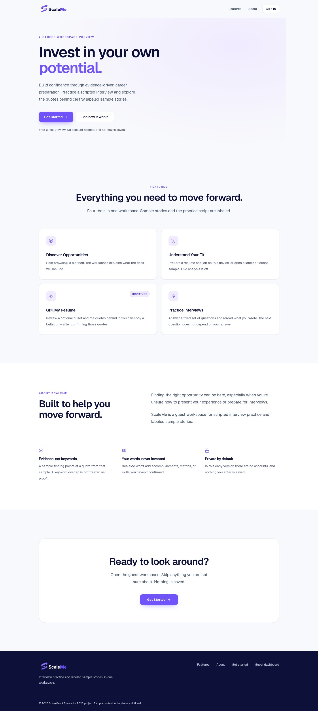
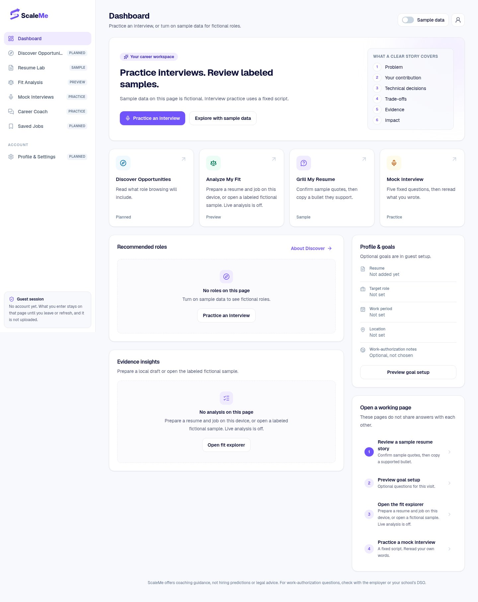

# ScaleMe

**Invest in your own potential.**  
An evidence-first career-preparation prototype built by an Arizona State University student team for **SunHacks 2026** (November 14–15).

ScaleMe explores how candidates can explain their experience better *without inventing qualifications*. It brings resume extraction, role-requirement exploration, interview practice, and source-grounded resume improvement into one web experience.

> **Status (November 2026):** Hackathon prototype, not a production career service. Some workflows use explicitly fictional data or local processing. Paid AI endpoints require private authorization and are off by default. Please use **synthetic resumes** for evaluation.

## What works

| Area | Implementation | Boundary |
| --- | --- | --- |
| Web experience | Responsive Next.js/TypeScript landing page, guest dashboard, onboarding, and workspaces | Dashboard sample data is fictional |
| **Rust PDF parser** | Text-based PDF extraction, basic section detection, typed JSON contract, CLI/library, and automated tests; wired to a Next.js upload endpoint | Upload is **disabled by default**, owner-enabled, and time-limited; no OCR |
| Resume Lab | Explicit upload/extraction, text review, and local evidence-backed improvement flow | Upload does not automatically call AWS; no persistent resume storage |
| Fit Evidence Explorer | Requirements, supporting quotes, and labeled sample walkthroughs | The public explorer is **not live job-fit analysis** |
| Impact Lab | Local evidence ledger, before/after supported-requirement coverage, guarded improvement suggestions | Candidate claims are not independently verified |
| Interview | Scripted fictional practice; separate contextual interview and API integration | Bedrock-backed contextual interview is a **private preview**, not publicly enabled live AI |
| Job discovery | UI/workspace preview | Not connected to a production job-feed API |

## The differentiator: an inspectable evidence trail

Generic resume tools can produce polished language without showing where it came from. ScaleMe emphasizes the *source* behind a claim:

1. Compare a target requirement with the candidate's actual supplied material.
2. Mark whether there is supporting evidence, without treating an undocumented skill as a missing ability.
3. Ask the candidate for an example of relevant work.
4. Link proposed wording to an exact resume passage or candidate-reported answer.
5. Require candidate review and exclude unsupported achievements or invented metrics.

The **local Impact Lab** implements the conservative evidence-and-review workflow. The contextual interview is a separate, privately authorized pathway; fictional demos are always labeled. See [evidence design](docs/EVIDENCE_LEDGER.md), [differentiation](docs/DIFFERENTIATION.md), and [contextual interview limits](docs/CONTEXTUAL_INTERVIEW.md).

## Engineering spotlight: Rust PDF parsing

The real Rust component lives in [services/resume-parser](services/resume-parser/). It is a **PDF text extraction service**, not a Rust job-matching engine. It:

- Parses text-based PDF resume bytes and extracts text and section structure.
- Normalizes extracted text without manufacturing or rewriting candidate experience.
- Emits a shared JSON resume contract, validated again by the TypeScript server.
- Rejects unsupported, oversized, unreadable, or image-only documents.
- Performs no OCR, network requests, AI calls, or document storage.
- Includes CLI, contract, invalid-input, robustness, and synthetic-resume tests.

The [Next.js upload route](web/src/app/api/resume/parse/route.ts) invokes the Rust executable as a bounded, shell-free subprocess. PDF bytes are sent through standard input and structured JSON is received through standard output. The integration enforces request, size, timeout, and concurrency limits and requires explicit owner activation. These are **prototype safeguards**, not production security certification.

[Explore the Rust source](services/resume-parser/src/) · [Parser guide](services/resume-parser/README.md) · [Upload safeguards](docs/PUBLIC_PDF_DEMO.md)

## Technology and architecture

| Layer | Stack | Purpose |
| --- | --- | --- |
| User interface | Next.js 16, React, TypeScript, Tailwind CSS | Workspaces and responsive UI |
| Parsing | Rust, pdf-inspector, Serde | PDF text extraction and typed JSON |
| App backend | Next.js route handlers, Zod, Node.js subprocesses | Validation and parser orchestration |
| Optional AI | AWS Bedrock through AWS SDK Converse | Protected fit and interview endpoints |
| Testing / delivery | Cargo, Vitest, GitHub Actions, Docker, Railway configuration | Automated checks and packaging |

**Implemented PDF path:** Resume Lab → Next.js upload API → Rust parser executable → validated Resume JSON → browser review / local Impact Lab.

**Separate optional AI path:** Privately authorized contextual interview → protected fit/interview API → AWS Bedrock, only if explicitly enabled by the owner. PDF upload itself does not call Bedrock.

The repository does **not** implement the earlier proposed Rust requirement matcher or AWS Lambda/S3 upload architecture. It does not claim a production applicant database or publicly verified live-model deployment.

## Run locally

Prerequisites: Node.js 22+, npm, and Rust/Cargo for the PDF parser.

**Web app**

~~~bash
git clone https://github.com/charlierichards13/ScaleMe.git
cd ScaleMe/web
npm ci
npm run dev
~~~

Open http://localhost:3000. The welcome page, dashboard, fictional samples, and local evidence workflows can be explored without AWS. In PowerShell, use npm.cmd when execution policy blocks npm.ps1.

**Rust parser** — run from repository root:

~~~bash
cargo test --manifest-path services/resume-parser/Cargo.toml --locked
cargo build --manifest-path services/resume-parser/Cargo.toml --locked --release
~~~

**Web checks** — run from web/:

~~~bash
npm run lint
npm exec -- next typegen
npm exec -- tsc --noEmit
npm test
npm run build
~~~

The web development server does **not** automatically enable PDF uploading: the Rust executable and an explicit time-limited upload configuration are required. See [demo configuration and rollback](docs/PUBLIC_PDF_DEMO.md), [integration notes](docs/RESUME_UPLOAD_INTEGRATION.md), and [deployment](docs/DEPLOY_RAILWAY.md). Do not submit real applicant documents to this prototype.

GitHub Actions also checks the Rust crate and the Linux container upload path. Passing CI is not a deployment or a security audit.

## Explore the workspaces

| Route | Scope |
| --- | --- |
| / and /dashboard | Welcome and guest dashboard |
| /resume-lab | Rust-backed PDF workflow when owner-enabled; local/pasted-resume options |
| /fit-insights | Clearly labeled fictional evidence explorer |
| /impact-lab | Local requirement evidence and candidate-reviewed suggestions |
| /interview | Scripted mock interview |
| /interview/contextual | Privately authorized contextual interview preview |

## Trust boundaries and limitations

- **Synthetic inputs only for evaluation.** PDF safeguards are not a full third-party security/privacy review.
- **No fabricated experience.** Supported coverage measures documented evidence, not hiring probability; candidate-reported claims are not independently verified.
- **No surprise inference.** Local parsing and evidence review do not automatically invoke paid AWS services; the Bedrock integration is protected and off by default.
- **No production job retrieval, Rust requirement matcher, or public applicant service.** These remain possible follow-up work.
- **Some detailed design docs are historical.** The [original roadmap](docs/ROADMAP.md) includes proposed and superseded items; use this README for the present project scope.

Read [SECURITY.md](SECURITY.md), the [threat model](docs/security/THREAT_MODEL.md), and the [private AI readiness review](docs/RAILWAY_PRIVATE_DEMO.md) for details.

## Project background

Built collaboratively at **ASU SunHacks 2026** through frontend, AI/backend, Rust, and integration workstreams. The project reflects the team's interest in evidence grounding, defensive file processing, explicit trust boundaries, and honest demonstration of AI capabilities.

[Source repository](https://github.com/charlierichards13/ScaleMe) · [Contributor guide](CONTRIBUTING.md)

*Help people tell the truth about their experience—and tell it better.*
