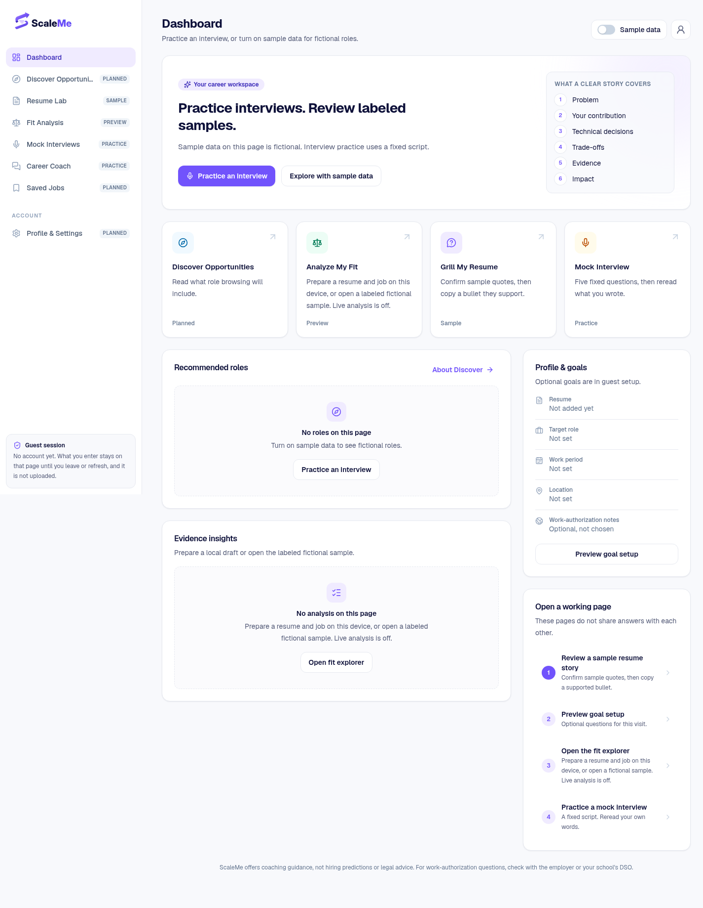
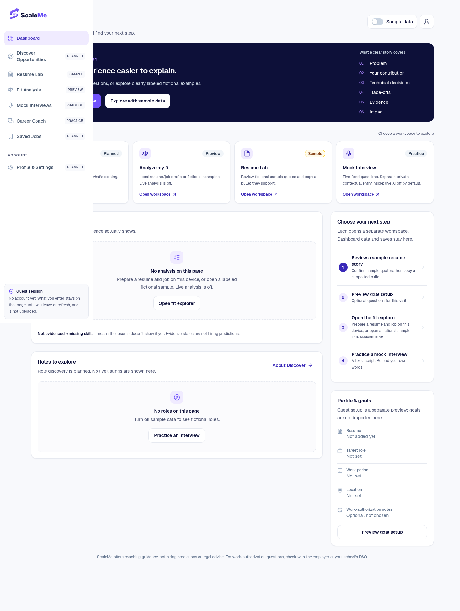
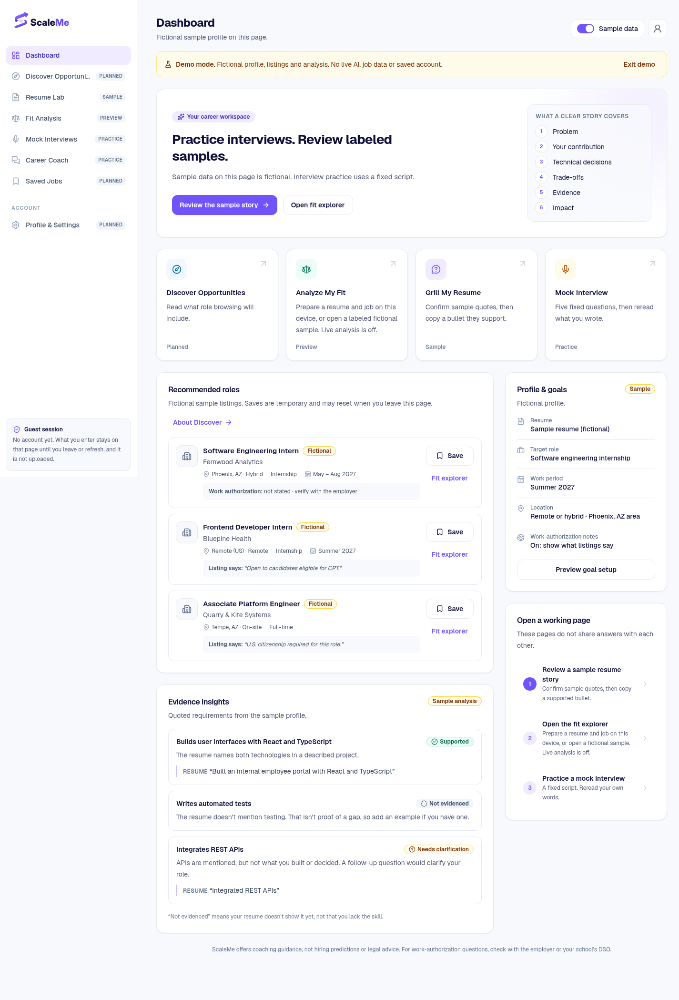
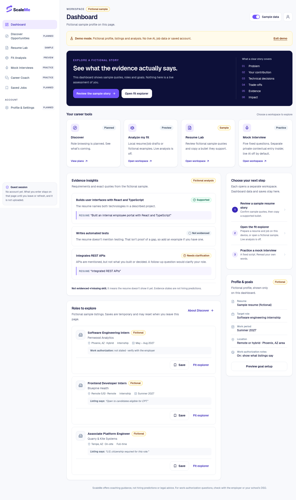
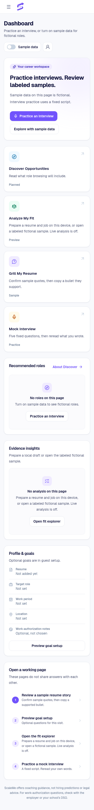
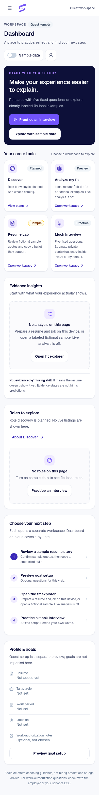
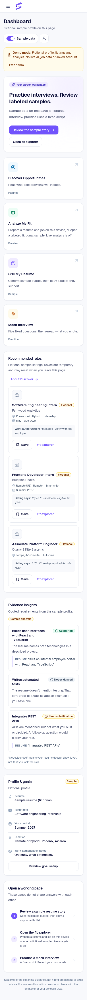
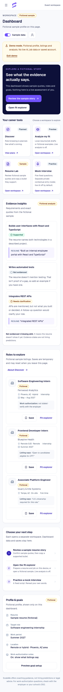
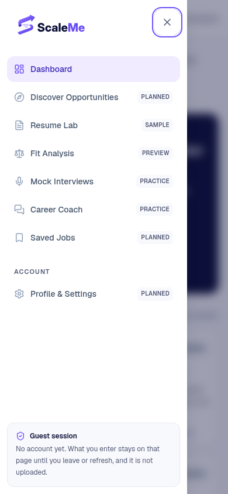

# Phase B: dashboard and shared workspace verification

Implements [Issue #58](https://github.com/charlierichards13/ScaleMe/issues/58) on
`feat/dashboard-workspace-polish`. Baseline: freshly fetched `origin/main`
`8a95366e2a86a65b5a6e43318580b53b5ba00e19`, including merged #56 and #57.
Repository owner/reviewer: @charlierichards13. Draft review only; no merge or deployment.

## Visible scope

- Dashboard: ink welcome panel, clearer guest/sample identity, visible career-tools
  heading, two-column mobile/four-column wide-desktop cards, consistent status badges,
  restrained brand accents and equal card heights within each row.
- Evidence appears before roles. Exact sample quotations have a tinted source block;
  **Not evidenced ≠ missing skill** stays visible in both states. No fit score is added.
- Roles have a separate action row, conspicuous fictional labels and unchanged
  work-authorization quotations/cautions. Save/unsave remains dashboard-only memory.
- Next actions precede the profile summary, with explicit independent-workspace copy.
  Guest setup does not populate this dashboard. Sample mode is explicitly selected,
  reversible, and resets temporary saves when toggled. It never runs analysis.
- Shared primitives: 44px minimum button targets, darker brand text for links,
  wrapping badges/headings, existing brand focus rings and responsive card padding.
- Shared shell: full navigation labels, compact guest header, approved unmodified SVGs.
  The mobile drawer uses native `dialog.showModal()` for background inertness and focus
  containment; close button first, Escape, focus return, backdrop dismissal, close on
  navigation, scroll lock with cleanup, and close on crossing the desktop breakpoint.

The welcome hero/identity, onboarding, route constants, fixtures, feature-owned pages,
API/AI/backend/auth/parser/storage/integration code, dependencies and lockfiles are unchanged.
The shared button primitives do affect their existing consumers; browser regressions cover
these shared surfaces. No threat-model/API-contract change is needed: no input source,
data recipient, external call, permission, logging or persistence is introduced.

## Capability boundaries checked against merged main

| Entry | Actual destination and disclosure |
| --- | --- |
| Discover | `/discover-preview`: planned placeholder, not job sourcing |
| Analyze my fit | `/fit-insights`: local resume/job drafts and explicitly selected fictional examples; live analysis off |
| Resume Lab | `/impact-lab`: dashboard entry describes the fictional sample quote/review/copy path. Existing independent local-input workflow is preserved |
| Mock Interview | `/interview`: five fixed questions, plus the existing separate `/interview/contextual` entry from #57 |
| Contextual entry | Private interview/evidence-report workflow; live model off by default. No generally available live inference or verified real-world model quality is claimed |

Sample profile, jobs and assessments remain fictional. Nothing is passed from the
Dashboard to another page. The contextual page's existing same-session report is a
separate integrated workflow; it was not changed here. No paid/model requests are made
by the dashboard. Guest/account, upload, persistent saving, legal advice and hiring
prediction limitations remain in place.

## Verification

Run from `web/` with Node 22+ and Chromium available:

```bash
npm ci --ignore-scripts --cache /workspace/work/npm-cache
npm run lint
npm exec -- next typegen
npm exec -- tsc --noEmit
npm test
npm run build
npm audit --audit-level=high --cache /workspace/work/npm-cache
npm run start -- --hostname 127.0.0.1
# In a second shell, against the production server:
SCALEME_SCREENSHOT_DIR=../docs/screenshots/dashboard-phase-b node scripts/dashboard-workspace-smoke.mjs
node scripts/evidence-ledger-smoke.mjs
node scripts/contextual-impact-smoke.mjs
# From repository root:
git diff --check
```

Local dependency installation skips lifecycle scripts and uses a writable task cache;
no dependency versions change. The initial default-cache install could not write the
sandboxed home cache; rerunning with the task cache succeeded. Existing ESLint peer-range
warnings remain at install time.

| Check | Observed result |
| --- | --- |
| Lint | Pass, no warnings |
| Next typegen / TypeScript | Pass |
| Unit tests | 24 files, 424 tests passed; external-model tests use mocks |
| Production build | Pass; existing unset `SITE_URL` / `metadataBase` localhost warning remains |
| High/critical npm audit threshold | Pass; 9 existing moderate development-tool findings, dependencies unchanged |
| Dashboard browser regression | Pass in production Chromium; details below |
| Existing evidence-ledger browser suite | Pass: local input/sample, vague/relevant/contradictory answers, quotes, review/copy gate, clipboard, mobile, reload isolation |
| Existing contextual-impact browser suite | Pass: three fictional profiles, mocked transport, explicit associations, no unlinked/vague gain, exact provenance, review reset, mobile, reload isolation |
| Diff whitespace | Pass |

Dashboard checks at **320, 390, 768, 1024 and 1440px** cover empty/sample state, all four
card routes, paired card heights, sample quotations and all three evidence labels,
save/unsave, sample-toggle save reset, and no horizontal overflow. A 720px CSS viewport
models reflow on a 1440px display at 200% zoom; a separate 200% root-font enlargement
also has no overflow. This is a layout/large-text check, not OS/browser-menu zoom automation.
The primary guest CTA stays in the first mobile viewport. All four tools occupy two rows
on phones rather than four long stacked cards.

Keyboard/pointer checks cover visible skip link and focus ring; Enter opens the native
modal and focuses its close control; forward/reverse Tab cannot reach background controls;
explicit attempts to focus the sample switch while modal are blocked. Escape returns focus
to the trigger. Pointer dismissal, link navigation/closure and 1024px breakpoint closure
restore body scrolling. Native Tab traversal may pass through browser chrome, as expected;
no background page control is reachable. The test harness supplies the Enter character event
required by CDP, in addition to keydown/up.

Shared placeholder/workspace initial layouts are also checked for overflow at 320, 390 and
1440px. Every dashboard CTA/next-step destination returns 200. The separate contextual
entry remains present. Visible logos load original light-surface assets. Dashboard/shared
navigation checks observe no API, non-GET or external requests, browser storage or runtime
errors. Existing contextual browser tests explicitly intercept model/API transport with
fictional responses; these are not live model checks.

Selected WCAG text contrast calculations (sRGB): primary white/brand **4.83:1**,
ink/white **18.26:1**, muted/white **6.78:1**, brand-strong link/white **9.68:1**,
hero slate-300/ink **12.30:1**, hero highlight/ink **6.61:1**. New UI has no animation
requirement; the existing reduced-motion override applies to transitions. Browser checks
run with reduced motion. No blanket accessibility conformance is claimed.

## Before / after screenshots

All screenshots contain only empty guest state or bundled fictional data. Before images
were captured from a detached baseline checkout at `8a95366`, after font/layout settling;
after images come from the Phase B production build. Desktop: 1440px; phone: 390px.

| State | Before | After |
| --- | --- | --- |
| Empty desktop | [](screenshots/dashboard-phase-b/before-empty-1440.png) | [](screenshots/dashboard-phase-b/after-empty-1440.png) |
| Sample desktop | [](screenshots/dashboard-phase-b/before-sample-1440.png) | [](screenshots/dashboard-phase-b/after-sample-1440.png) |
| Empty phone | [](screenshots/dashboard-phase-b/before-empty-390.png) | [](screenshots/dashboard-phase-b/after-empty-390.png) |
| Sample phone | [](screenshots/dashboard-phase-b/before-sample-390.png) | [](screenshots/dashboard-phase-b/after-sample-390.png) |

[](screenshots/dashboard-phase-b/after-drawer-390.png)

## Three-minute judging route (fictional, no live AI)

1. **0:00–0:25 — Guest dashboard.** Show the empty state and four tool/status labels.
   Explain that fixed practice works without an account and Discover is planned.
2. **0:25–1:05 — Select sample data.** Point out the fictional banner, exact resume
   quotations and Supported / Not evidenced / Needs clarification states. Explain that
   these describe evidence, not someone's abilities or a hiring probability.
3. **1:05–2:20 — Resume Lab.** Open the existing page, choose **Load fictional sample**,
   then use the sample's web-testing answer: “I tested login, navigation, and the mobile
   layout with coworkers before rollout.” Reassess, inspect exact candidate-reported
   sources, then show the two confirmation gates before copying supported wording.
   This is an independent local coaching example, not dashboard data transferred into it.
4. **2:20–3:00 — Practice and honest boundaries.** Return to the dashboard and open Mock
   Interview. Show the five fixed questions and separate contextual entry. Explain that
   private live inference is off by default and real-model quality remains unverified.
   Finish with the evidence-first message: a clearer story without invented achievements.

## Remaining limits / review

- Chromium only; Safari/Firefox, mobile hardware and manual screen-reader testing are
  not verified. Native dialog requires a modern browser. Human accessibility review remains useful.
- No real data, live-model rehearsal, public-launch security claim, deployment URL,
  configuration activation, merge or deployment. `SITE_URL` remains unset; an owner-approved
  origin is needed before publishing. The warning is pre-existing, not resolved with an invented URL.
- Rust source is unchanged; GitHub CI retains its existing Rust checks. Local verification
  is scoped to frontend and the existing browser suites.
- Existing lexical evidence-review limitations, private-preview access/cost gates,
  international-student cautions and provider/privacy launch gates still apply.
- No major feature-owned redesign was needed; no follow-up issue or integration changes added.
