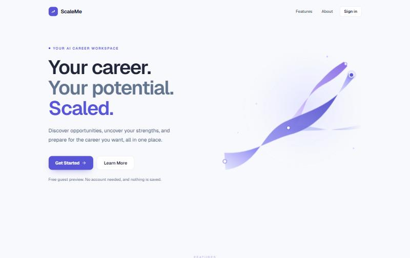
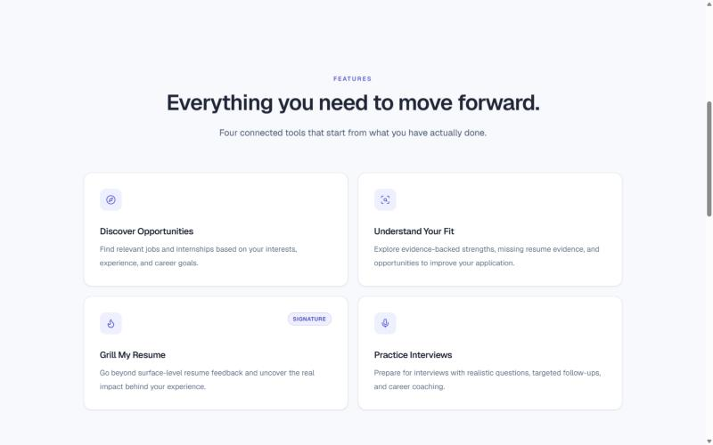
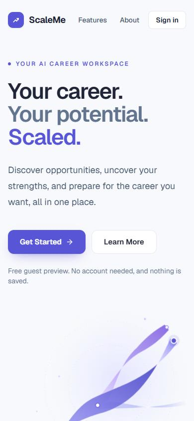
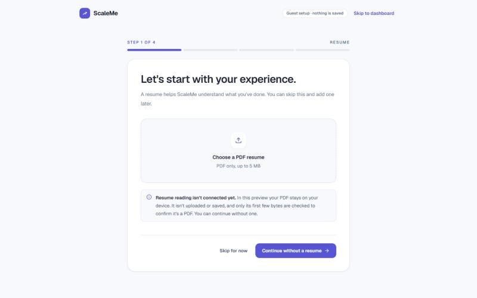

# Welcome page and first-time onboarding (Issue #43)

**Branch:** `feat/welcome-onboarding` · **Status:** frontend only. No new API routes, storage, authentication, AI calls or network requests.

## Routes

| Route | What it is | File |
| --- | --- | --- |
| `/` | Public welcome page: Navigation → Hero → Features → About → Final CTA → Footer | `web/src/app/page.tsx` |
| `/onboarding` | Four-step guest setup, reached from every *Get Started* button until working accounts exist (`getStartedHref()` in `web/src/lib/auth-status.ts`) | `web/src/app/onboarding/page.tsx` |
| `/dashboard` | The existing career dashboard from PR #31, unchanged. It was previously served at `/` | `web/src/app/(workspace)/dashboard/page.tsx` |

Every other route (`/coach`, `/impact-lab`, `/fit`, `/interview`, `/resume-lab`, `/saved`, `/settings`, `/discover-preview`) is unchanged.

Links that meant "the dashboard" now use `routes.dashboard` instead of a hard-coded `/`: the sidebar logo, the Coach's *Back to dashboard* link, the Impact Lab wordmark, the Fit Evidence Explorer logo (`/fit-insights`, merged from `main` in PR #41), and the 404 page (which also links to the welcome page). `web/src/lib/routes.test.ts` fails CI if any route group defines a page at `/` again, which would collide with the welcome page.

## Welcome page

- **Server component, no client JavaScript of its own.** Anchor links, the sign-in note (native HTML `popover`) and all motion are plain HTML and CSS.
- **Components** live in `web/src/components/welcome/`: `SiteHeader`, `Hero`, `HeroArt` (+ generated `hero-ribbon.ts`), `Features`, `About`, `FinalCta`, `SiteFooter` and shared classes in `styles.ts`. Colors reuse the existing tokens in `globals.css`. Fonts reuse Geist. No new dependencies.
- **Hero artwork** is an original SVG sculpture: one continuous satin ribbon that rises in a widening spiral and unfurls to the upper right. It's modeled in 3D by `web/scripts/generate-hero-art.mjs` (centerline, tilt, tapering width, thickness, a key and fill light with a satin sheen, and mild perspective) and baked into about 120 static pieces in `hero-ribbon.ts`. Each piece is one path with its own shading gradient. Pieces are drawn back to front so folds overlap correctly, and side walls give the band thickness. There is no canvas, WebGL, runtime geometry or randomness, so server and client render identical markup. To change the form, edit the art-direction constants at the top of the script and run `node scripts/generate-hero-art.mjs` from `web/`.
- **Content integrity:** no testimonials, statistics, hiring probabilities, company claims or contact details. The About principles ("Evidence, not keywords", "Your words, never invented", "Private by default") restate the repository's integrity rules and current guest-only behavior. Keep them true if that changes.

### Motion

Motion is only enabled under `prefers-reduced-motion: no-preference` (see the Issue #43 block in `web/src/app/globals.css`):

- Hero art: a 16 s float (9 px, with a slight tilt), a contact shadow that tightens in step with it, and a faint white highlight that drifts across the ribbon's faces over 14 s (clipped to the faces, so it never touches the background).
- Hero text: a single 800 ms settle on load that starts at 40% opacity, so the text stays readable if a background tab stalls the animation.
- Section reveals use scroll-driven animations (`animation-timeline: view()`), so they need no JavaScript. Browsers without support, and users with reduced motion, see the content immediately.
- Hover, focus and active transitions only change color, shadow or transform, so nothing shifts the layout.

## Sign-in boundary (Issue #42)

`/sign-in` and `/sign-up` belong to Issue #42 on another branch and are **not** created or modified here. Issue #42 builds those screens only (UI), not working authentication.

`web/src/lib/auth-status.ts` keeps two facts separate on purpose:

- `authPages` lists where the sign-in and sign-up screens live. A screen existing does **not** mean anyone can create an account or sign in.
- `accountsEnabled` (currently `false`) is set to `true` only in the PR that ships real, server-side authentication: account creation, server-verified sessions, and onboarding answers stored with access control, after its security and privacy review. It's never inferred from a page existing, a client flag or a cookie.

While `accountsEnabled` is `false`, which stays true even after the #42 screens merge, the welcome page keeps everyone on the working guest path: *Get Started* → `/onboarding` → `/dashboard`. The header's *Sign in* button opens a short note explaining that accounts aren't available yet, with links to the guest setup and the dashboard. Nothing links visitors into a registration form that can't create accounts, and nothing fakes a login or session. When `accountsEnabled` becomes `true`, `getStartedHref()` sends *Get Started* to `/sign-up` and *Sign in* becomes a real link. A route test fails if accounts are enabled while either screen is missing.

## Onboarding

`OnboardingFlow` (client component) drives a pure reducer in `web/src/lib/onboarding/state.ts`:

| Step | Heading | Inputs (all optional) |
| --- | --- | --- |
| 1 Resume | Let's start with your experience. | Optional PDF picker (see below) |
| 2 Goals | What would you like to accomplish? | Multi-select: internship, full-time job, improve resume, interviews, explore |
| 3 Preferences | What does your ideal opportunity look like? | Role/field and location (100 characters max), remote/hybrid/on-site (multi-select), timing as labeled periods ("A fall semester", "Not sure yet" and so on), never invented dates |
| 4 Personalize | One last thing: make ScaleMe yours. | International-student guidance toggle; job-update toggle marked *Not available yet* |
| Done | Your career workspace is ready. | Summary of answers and a *Go to Dashboard* link |

- **Navigation:** *Continue* (also Enter in a text field), *Back*, and *Skip for now* on every step. Skip clears that step's answers and advances. Focus moves to each new step's heading. A *Skip to dashboard* link is always visible.
- **Controls** are native checkboxes, radios and labeled text inputs, styled as large cards, so keyboard and screen-reader behavior comes from the browser.
- **Honesty:** the completion screen says that answers aren't saved and that the dashboard doesn't use them yet. Choosing goals never limits access to any tool.
- **International students:** the toggle only describes future general information about listing statements (CPT, OPT, STEM OPT, sponsorship, citizenship). It states that ScaleMe never decides eligibility or asks for immigration documents, and refers users to their DSO or an immigration attorney.

### Resume picker (not an upload)

No secure PDF parser exists on `main` (Issue #4), so the picker only checks the chosen file locally:

1. Name ends in `.pdf`, MIME type is empty or `application/pdf`, size is between 1 byte and 5 MB (`checkResumeMetadata`).
2. The first five bytes are `%PDF-` (`hasPdfSignature`); only those bytes are read.
3. Only the file name and size are kept in component memory. The file is never uploaded, parsed, stored or sent anywhere.

These checks are **UX only, not a security control**. Any future upload must repeat every check on the server, plus parser time and page limits, per the threat model.

### State and persistence

Answers exist only in React state for the current page. A reload or navigation away discards them. Nothing is written to `localStorage`, `sessionStorage`, cookies, IndexedDB or a server.

### Future integration (not built)

1. Sign-up (Issue #42) redirects new users to `/onboarding`; returning users skip it. This needs a server-side "onboarding completed" flag, not a client-side check.
2. On *Finish setup*, POST the answers to a validated server route (runtime schema, length limits) and store them with the account under a reviewed retention policy. That requires a privacy and threat-model review **before** it ships.
3. Resume upload connects to the Issue #4 parser behind server-side validation. The dashboard then reads the saved profile instead of its empty state.
4. Protect `/dashboard` and the workspace routes with real authorization once accounts exist.

## Tests

- `web/src/lib/onboarding/state.test.ts`: step order and bounds, back/skip/next transitions, skip clearing only its own step, multi-select toggling, text normalization and the 100-character cap, opt-in defaults, resume metadata only, honest summary wording, and the resume checks (extension/MIME/size and the `%PDF-` signature versus a renamed HTML file).
- `web/src/lib/routes.test.ts`: `/` is the welcome page, the dashboard is at `/dashboard`, `/onboarding` exists, no route-group page collides with `/`, the sidebar points at `/dashboard`, `isActive` matching, and the account boundary: accounts are off in this build, *Get Started* and *Sign in* stay on the guest path unless `accountsEnabled` is true (regardless of whether the #42 screens exist), and accounts can't be enabled while either screen is missing.
- `web/src/app/motion.test.ts`: every `animation` and smooth-scroll declaration in `globals.css` sits inside the `prefers-reduced-motion: no-preference` block, and the hero entrance starts at least 40% visible. A planted out-of-block animation was confirmed to fail it. It also lists the hero sculpture's `sm-float`, `sm-sheen` and `sm-shadow` animations.

Component interaction tests would need a DOM test environment, which isn't set up. The browser checks below cover interactions.

## Manual verification (2026-11-14, `next dev` and `next start`)

- 1440, 768 and 390 px: no horizontal overflow (`scrollWidth` ≤ viewport).
- Features and About anchors scroll to their sections. All three *Get Started* links go to `/onboarding`.
- The sign-in note opens, closes with Escape and returns focus to the button.
- Onboarding at 390 px: keyboard multi-select with visible focus rings, Enter submits a step, focus moves to each new heading, Skip advances and clears, *Finish setup* shows the correct summary, and *Go to Dashboard* opens `/dashboard` with the sidebar's *Dashboard* item active.
- A synthetic `evil.pdf` containing HTML was rejected by the signature check. A synthetic file named with `<b>` markup was rendered as plain text.
- No `/api` requests and no console errors during the flow. All existing routes return 200, including `/fit-insights` (PR #41, merged from `main`). `/sign-in` returns 404 as expected (Issue #42).
- Reduced motion is enforced by `motion.test.ts` (all motion inside the `no-preference` media query). It wasn't emulated in a browser, because the browser tooling can't toggle `prefers-reduced-motion`.

## Screenshots (production build, synthetic content only)

