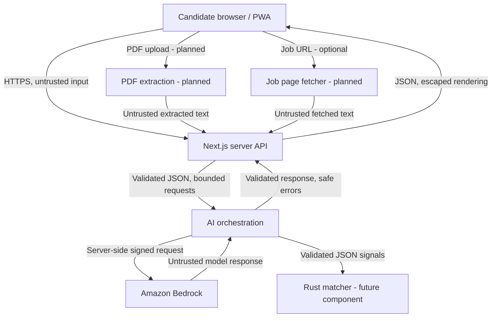

# ScaleMe threat model (living document)

**Version:** draft 0.1 · **Status:** design review, not certification.  
**Scope:** Next.js web/PWA, server-side AI API, AWS Bedrock, future Rust matcher, PDF uploads and job URL ingestion.  
**Frameworks:** [OWASP ASVS 5.0](https://asvs.owasp.org/); [OWASP GenAI LLM Top 10 (current)](https://genai.owasp.org/llm-top-10/).

This document is a required reference for any change that introduces a service, data field, input source, privileged tool, persistence, or external call. **Statuses below mean proposed controls until verified in code and tests.**

## Security goals

1. Protect private candidate data, interview history, credentials and service logs.
2. Prevent untrusted resume/job text from affecting system instructions, permissions or server actions.
3. Avoid false, unsupported career advice and prevent applicant cross-session leaks.
4. Contain cloud usage/cost and deny untrusted network access.
5. Preserve reproducible, reviewable builds and protect code integrity.

## System sketch

The diagram is **architectural intent**. A direct Bedrock integration and mocked tests are currently being developed separately; do not infer deployment, storage or security controls exist solely from this drawing.

## Trust boundaries and assets

| Boundary | Attacker-controlled surface | Protected asset |
| --- | --- | --- |
| Browser → API | JSON, query strings, headers, cookies, file names, size | Cloud spend, server process, candidate data |
| PDF → parser → API | Embedded text, malformed PDFs, metadata | Availability, filesystem, prompt integrity |
| Job URL → fetcher → API | URL, redirects, DNS, server responses, embedded instructions | Internal network/AWS metadata service, backend secrets |
| API → Bedrock → API | Context/data sent to provider, model-generated JSON | Applicant privacy, decision correctness, cost |
| Server → Rust | Untrusted JSON/arguments and executable packaging | Process control, integrity and stability |
| CI / contributor → Git | Malicious or vulnerable packages, prompt-injected files, credentials | Repository integrity and workflow tokens |
| Future persistence / accounts | Stored records, session identifiers | Cross-user confidentiality and authorized access |

## Prioritized threats and planned defenses

**High** = address before a public/unauthenticated launch. **Medium** = investigate/test as part of MVP or before using real data. The priorities are project-level engineering judgments, not measured risk scores.

| Threat | Priority | Required control | How to verify | Current known state |
| --- | --- | --- | --- | --- |
| **LLM prompt injection** in resume, job text, or fetched pages | High | Separate system instruction from untrusted content; prevent AI-initiated actions; validate evidence and schema; reject tool/secret requests | Adversarial synthetic inputs against real configured model and response validation | Prompt boundaries + mocked tests reported by Claude, live behavior unverified |
| **Sensitive information disclosure** via logs, model response, history or cross-user access | High | Data minimization; no raw request logging; private-by-default sessions; no secrets in prompts; retention policy | Code inspection, seeded PII canaries, negative tests, session boundary tests | Log redaction claimed in local work, not independently inspected; storage not yet designed |
| **Unbounded inference/cost** (public API abuse, large loops) | High | Per-client limits, concurrency caps, body/turn caps, timeouts, output-token caps, AWS budgets/alarms | Burst/concurrency and huge-input tests; AWS cost monitoring | Some request-size/timeout limits reported; **rate limiting absent** |
| **SSRF** through user-provided job URLs | High | HTTPS/allowed host policy, strict DNS/IP validation at each fetch/redirect, deny private/loopback/link-local/metadata targets, response byte/time caps | Safe blocked-URL unit tests including 127.0.0.1, link-local, redirects, DNS rebinding edge cases | Job ingestion is planned/assigned; not verified |
| **Malicious PDF / parser denial of service** | High | MIME+magic inspection, maximum size/pages, parser time/memory limits, no executable conversions, isolated parsing where viable | Invalid, corrupt, image-only, oversized and complex PDF tests | Resume parser assigned, not verified |
| **Model output injection / unsafe rendering** | High | Runtime response schemas, escape text, no direct HTML injection or executing output | HTML/script payload test, oversized/malformed JSON, no `dangerouslySetInnerHTML` | Zod and evidence checks claimed in local AI code; UI integration unknown |
| **Cloud key leak / overprivileged role** | High | SDK default credential chain server-only; least-privilege IAM, secrets rotation, no client-accessible credentials | Inspect env usage, bundle, IAM role and logs, secret scanning | Design documented; AWS account configuration not verified |
| **Dependency or CI supply-chain compromise** | Medium | Lockfiles, Dependabot, npm audit, human review, read-only workflow tokens | CI logs, dependency changes, action review | CI exists; vulnerability advisories observed, not all resolved |
| **Fabricated claims / false eligibility guidance** | Medium | Quote-grounded evidence, unknown != ineligible, human-verifiable outputs, clear disclaimer | Test ungrounded metrics and visa/sponsorship statements | Fit evidence checks reported; employer guidance is future scope |
| **CSRF/CORS/auth errors** after accounts or cross-origin API clients | High once applicable | Explicit identity/authorization design, session binding, origin/CSRF checks, access control | Cross-user, wrong-origin, privilege escalation tests | No accounts planned in first MVP; revisit with auth or Expo client |

## Known gaps from Claude's uncommitted Issue #6 report

The 2026-11-14 Claude transcript describes a working `POST /api/fit/analyze` route, Zod input/output checks, quoted-evidence verification, 28 passing **mocked** tests and a DEMO-only mode. It also explicitly reports **no live Bedrock test, no rate limiting, no caching/retry, and no Rust integration**. These claims require source review and CI after a PR exists.

**Important:** A random delimiter/tag in the prompt is not a security boundary. A model can still follow adversarial instructions. Defense-in-depth should rely on **no privileged model tools**, strict outputs, evidence verification and application-side authorization.

## Review triggers

Update this file whenever an agent changes:
- External service/model provider, prompt contents, tool permissions, inference settings, pricing or rate limits.
- What applicant data is collected, processed, logged, retained, shared or persisted.
- Upload parser, job URL fetching behavior or network egress.
- Authorization, sessions, user identity, public hosting, API routing or storage.
- Dependency trust, CI privileges, or cloud IAM.

Capture the change in the same PR and add corresponding tests to [Review Checklist](REVIEW_CHECKLIST.md). A reviewer signs off on new high risks **before** public exposure.

## Tracking high-priority security work

- [#23 — Rate-limit and cost-protect Bedrock endpoints](https://github.com/charlierichards13/ScaleMe/issues/23)
- [#24 — Adversarial AI/privacy review](https://github.com/charlierichards13/ScaleMe/issues/24)
- [#4 — Safe resume PDF parsing](https://github.com/charlierichards13/ScaleMe/issues/4)
- [#5 — Safe pasted job and URL ingestion](https://github.com/charlierichards13/ScaleMe/issues/5)

## Open decisions (human-owned)

- How will abuse limits be enforced across deployment instances (shared store vs trusted gateway)?
- Which Bedrock model, region, retention options and least-privilege resource ARN are actually permitted in the AWS account?
- Is the prototype available to the public, or kept local/private using only synthetic data?
- Are interview histories persisted? If so, how are records encrypted, authorized and deleted?
- Where does the Rust matcher execute in hosted environments without arbitrary executable support?
- Will job URL retrieval be restricted to a documented allowlist or delegated to a trusted provider?

Record answers as dated decisions in this file. No agents should silently make these policy decisions.
