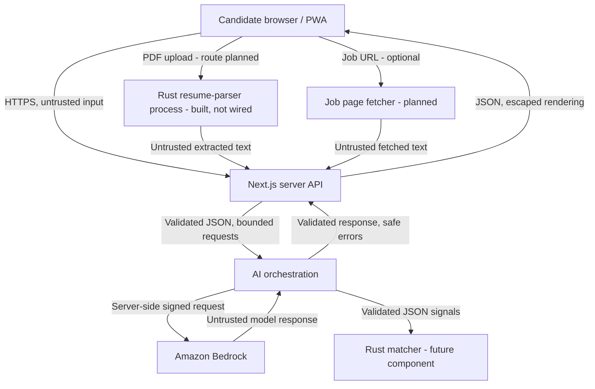

# ScaleMe threat model (living document)

**Version:** draft 0.1 · **Status:** design review, not certification.  
**Scope:** Next.js web/PWA, server-side AI API, AWS Bedrock, Rust resume parser (standalone, not yet wired to a route), future Rust matcher, PDF uploads and job URL ingestion.
**Frameworks:** [OWASP ASVS 5.0](https://asvs.owasp.org/); [OWASP GenAI LLM Top 10 (current)](https://genai.owasp.org/llm-top-10/).

This document is a required reference for any change that introduces a service, data field, input source, privileged tool, persistence, or external call. **Statuses below mean proposed controls until verified in code and tests.**

## Contextual interview private-preview update (2026-11-15)

This branch supersedes the historical "unauthenticated paid route" descriptions below at the **Next.js HTTP boundary**: `src/proxy.ts` guards both paid endpoints with a high-entropy owner-provided bearer access code and the existing default-off live switch. No shared UI, existing API handler or model prompt is replaced. Exact `demo=true` remains the free body-ignoring route. `/api/practice/access` checks authorization without AWS or quota use. Configuration is server-only; the browser receives no environment access code or AWS credential. A tester's manually entered app code lives in React memory, travels only in Authorization, and is cleared on finish/reset. Wrong/missing code and wrong-origin requests fail before paid handlers; errors are generic, uncached and contain no applicant text. No cookies are added.

The new `/interview/contextual` client explicitly sends resume/job/requirements, then full previous interview questions/answers and fit statuses to the existing APIs after disclosure and consent. React renders text, runtime schemas validate responses, every structured requirement must appear once, and unsupported/unknown provenance is rejected. Browser requests and responses are bounded, redirects prohibited, timeout/cancellation handled, and retries require an explicit click. Already admitted model calls may complete/be billed after cancellation. No persistence, logging of user text, telemetry, tools or external job/PDF ingestion is introduced. The local evidence handoff retains exact candidate-reported answers and question targets without asserting relevance or changing support statuses.

**Verified with mocked AWS:** three distinct fictional profiles/jobs, full five-answer sessions, previous answers in prompts, target continuity, no cross-profile leakage, no raw text/code in logs, retry preservation, anonymous denial, malformed/wrong-mode outputs, free demos and off-by-default configuration. Browser/production HTTP verification is recorded in the PR. These checks do not verify live model quality, provider retention, prompt-injection resistance or public-hosting behavior.

**Remaining risks:** shared private code grants access to a whole preview budget, provides no individual identity or per-user fairness, and requires secure owner distribution/rotation and HTTPS. No new account/database is added. The per-process cost budget remains restartable and is not a distributed hard cap. The access gate requires a Next.js server that executes proxy; direct route exports are internal functions, not independently authorized service entry points. Reconcile with future authentication/proxy changes and review the actual hosting boundary before any deployment. Do not deploy publicly; #49 still needs human review. Real personal data requires the existing provider retention/privacy review. [Integration and setup](../CONTEXTUAL_INTERVIEW.md).

## Security goals

1. Protect private candidate data, interview history, credentials and service logs.
2. Prevent untrusted resume/job text from affecting system instructions, permissions or server actions.
3. Avoid false, unsupported career advice and prevent applicant cross-session leaks.
4. Contain cloud usage/cost and deny untrusted network access.
5. Preserve reproducible, reviewable builds and protect code integrity.

## System sketch

The diagram is **architectural intent**. A direct Bedrock integration and mocked tests are currently being developed separately; do not infer deployment, storage or security controls exist solely from this drawing.

## Trust boundaries and assets

| Boundary | Attacker-controlled surface | Protected asset |
| --- | --- | --- |
| Browser → API | JSON, query strings, headers, cookies, file names, size | Cloud spend, server process, candidate data |
| PDF → parser → API | Embedded text, malformed PDFs, metadata | Availability, filesystem, prompt integrity |
| Job URL → fetcher → API | URL, redirects, DNS, server responses, embedded instructions | Internal network/AWS metadata service, backend secrets |
| API → Bedrock → API | Context/data sent to provider, model-generated JSON | Applicant privacy, decision correctness, cost |
| Server → Rust | Untrusted JSON/arguments and executable packaging | Process control, integrity and stability |
| CI / contributor → Git | Malicious or vulnerable packages, prompt-injected files, credentials | Repository integrity and workflow tokens |
| Future persistence / accounts | Stored records, session identifiers | Cross-user confidentiality and authorized access |

## Prioritized threats and planned defenses

**High** = address before a public/unauthenticated launch. **Medium** = investigate/test as part of MVP or before using real data. The priorities are project-level engineering judgments, not measured risk scores.

| Threat | Priority | Required control | How to verify | Current known state |
| --- | --- | --- | --- | --- |
| **LLM prompt injection** in resume, job text, or fetched pages | High | Separate system instruction from untrusted content; prevent AI-initiated actions; validate evidence and schema; reject tool/secret requests | Adversarial synthetic inputs against real configured model and response validation | Implemented (Issue #6, merged in PR #33): system prompt + randomized data tags, no model tools, schema and evidence checks. Verified by **mocked** tests only; **live model resistance unverified** |
| **Sensitive information disclosure** via logs, model response, history or cross-user access | High | Data minimization; no raw request logging; private-by-default sessions; no secrets in prompts; retention policy | Code inspection, seeded PII canaries, negative tests, session boundary tests | The fit route (PR #33) logs only error type names, HTTP status and fixed configuration hints, never request, resume or model text. The usage line added for cost tracking contains numbers only (token counts, latency, truncation flag), checked with a canary in mocked tests. These checks rely on mocked tests and self-review and are **not independently reviewed**. One live run's server log was checked and contained no request content. Full resume/job text is sent to Bedrock (see data flow below). Storage not designed; none exists |
| **Unbounded inference/cost** (public API abuse, large loops) | High | Per-client limits, concurrency caps, body/turn caps, timeouts, output-token caps, AWS budgets/alarms | Burst/concurrency and huge-input tests; AWS cost monitoring | Body/field caps (200 KB streamed, per-field limits), 45 s timeout and 3000 output-token cap (Issue #6). Issue #23: live calls **off by default** (`FIT_LIVE_AI_ENABLED`), one shared in-process budget of 10/min, 50/day and 2 concurrent calls, `429` before any AWS call, AWS SDK `maxAttempts` 1. Mock-tested; exercised once live with every limit set to 1. Per-call token usage is now logged as numbers for cost tracking. **Per-process, not distributed, no per-user fairness**. The owner-reported $20 project spend limit is a lagging backstop, so the route is still **not safe to expose publicly** (see "Cost guard" below) |
| **SSRF** through user-provided job URLs | High | HTTPS/allowed host policy, strict DNS/IP validation at each fetch/redirect, deny private/loopback/link-local/metadata targets, response byte/time caps | Safe blocked-URL unit tests including 127.0.0.1, link-local, redirects, DNS rebinding edge cases | Job ingestion is planned/assigned; not verified |
| **Malicious PDF / parser denial of service** | High | MIME+magic inspection, maximum size/pages, parser time/memory limits, no executable conversions, isolated parsing where viable | Invalid, corrupt, image-only, oversized and complex PDF tests | Issue #4: standalone Rust parser (`services/resume-parser/`) with a 5 MiB limit, `%PDF-` signature check, 20-page and 30,000-character limits, a process-level time budget and heap budget, and content-free errors. Tested with **synthetic PDFs only**; not independently reviewed; no real-world PDFs, compressed streams, decompression bombs or embedded fonts tested. **No upload route exists yet**, so the server-side upload controls (streamed body limit, rate limiting, process cap) are still to do. See "Issue #4 resume parser" below |
| **Model output injection / unsafe rendering** | High | Runtime response schemas, escape text, no direct HTML injection or executing output | HTML/script payload test, oversized/malformed JSON, no `dangerouslySetInnerHTML` | Zod validation, JSON extraction and evidence checks implemented (PR #33) and mock-tested; unknown extra keys are stripped. Model-written prose fields are length-checked, not fact-checked. UI integration unknown (frontend must render as escaped text) |
| **Cloud key leak / overprivileged role** | High | SDK default credential chain server-only; least-privilege IAM, secrets rotation, no client-accessible credentials | Inspect env usage, bundle, IAM role and logs, secret scanning | **Verified 2026-11-15 for local development.** The server uses the restricted role `ScaleMeDevBedrockInvoke`, which allows only Nova Lite in `us-east-2` and has the same policy as its permissions boundary. Allow and deny probes confirmed it. No access keys exist, and the env values were not found in the client bundle. Residual risk: the human's project login cache (renewable for up to 90 days) sits on the same machine as the source profile. Log it out after testing. See "Restricted Bedrock role" below |
| **Dependency or CI supply-chain compromise** | Medium | Lockfiles, Dependabot, npm audit, human review, read-only workflow tokens | CI logs, dependency changes, action review | CI exists. 2026-11-14 on `main` after the ESLint 10 bump (#29), rechecked for Issue #23: `npm audit --omit=dev` reports **0** (production); full `npm audit` reports **9 moderate**, 0 high/critical, all from `minimatch` in the ESLint/`typescript-eslint` dev toolchain (`npm audit --audit-level=high` exits 0). Not changed here; update deliberately, no forced fixes. Issue #23 adds no dependencies. New runtime deps: `@aws-sdk/client-bedrock-runtime`, `zod`; new dev dep: `vitest@4`. Issue #4 adds a **Rust** dependency tree for the parser only (nothing in `web/package.json`): `pdf-inspector` pinned to `=1.25.2` with default features, `serde`, `serde_json`, `getrandom`; 126 packages in the committed `Cargo.lock`, of which only `pdf-inspector`, `lopdf` and `ttf-parser` were looked at individually. OSV lookup of the lockfile on 2026-11-15: one informational advisory, `ttf-parser` 0.25.1 **unmaintained** (`RUSTSEC-2026-0192`). `cargo audit` is not part of CI yet |
| **Fabricated claims / false eligibility guidance** | Medium | Quote-grounded evidence, unknown != ineligible, human-verifiable outputs, clear disclaimer | Test ungrounded metrics and visa/sponsorship statements | Evidence quotes are checked as substrings of the input; `supported` without a verified resume quote is downgraded. Advice items are dropped if they contain numbers not in the inputs, or if a growth suggestion says to add or claim experience without a condition (keyword heuristic, mock-tested). Substring matching does not prove the quote supports the claim, and model explanations and summaries are not fact-checked. Employer guidance is future scope |
| **False provenance / inflated documented coverage** | Medium | Candidate-only source IDs, exact quote validation, stable requirement ID denominator, deterministic counting and human review states | Missing/irrelevant answers, spoofed evidence links, job text masquerading as candidate evidence, invented numeric claims | Evidence ledger and before/after coverage are proposed; not implemented or verified |
| **CSRF/CORS/auth errors** after accounts or cross-origin API clients | High once applicable | Explicit identity/authorization design, session binding, origin/CSRF checks, access control | Cross-user, wrong-origin, privilege escalation tests | No accounts planned in first MVP; revisit with auth or Expo client |

## Issue #6 fit-analysis implementation (merged to `main` in PR #33)

Status: merged to `main` in PR #33 after self-review by the implementing agent; it is **not** independently audited. Its unit tests are **mocked**. On 2026-11-15 one synthetic request went through the ScaleMe API to live Amazon Nova Lite (`amazon.nova-lite-v1:0`, `us-east-2`). It succeeded, but one clean request does not verify injection resistance or behavior across inputs. Details: [BEDROCK_REVIEW_NOTES.md](BEDROCK_REVIEW_NOTES.md) and [api-contract.md](../api-contract.md).

**Data flow introduced:** the candidate's full resume text and the job title, company and text leave the Next.js server for Amazon Bedrock in the configured `AWS_REGION` on every live call. This is the first flow of personal data to an external provider. In the verified setup the model is invoked **in-region** (`us-east-2`, no cross-region inference profile), so requests are not routed to other regions. Not yet documented or verified: Bedrock's data retention/logging settings (for example model invocation logging, which is not enabled by this project) and user disclosure/consent. Use synthetic data only until they are. Fields `filename`, `sourceUrl` and `sections` are accepted by the API but **not** sent. Nothing is stored; the response goes back to the caller only.

**Trust boundaries touched:** Browser → API (validated JSON); API → Bedrock (server-side SDK credentials, no tools or network access given to the model); Bedrock → API (untrusted model text, parsed as JSON and checked). A new unauthenticated route exists, `POST /api/fit/analyze`, which is cost-bearing when AWS is configured. `?demo=true` is a no-AWS path that ignores the body.

**Controls in code (mock-tested):** field and byte limits (streamed); Zod request and response schemas; per-request random tags around untrusted text with a system prompt that treats it as data; evidence-quote verification; `supported` downgrade; rejection of unsupplied requirement IDs; fixed server disclaimer; AWS errors mapped to fixed safe messages; logs contain error type only.

**Known residual risks:**
- Cost guard is local only (Issue #23, see below). Anyone who can reach a live-enabled server can use up its whole budget. The owner-reported $20 project spend limit pauses the project near the limit but relies on billing data that can lag; it is a backstop, not the primary control.
- Prompt injection: only the prompt wording, lack of tools, and post-checks mitigate it. A resume could still steer the model's *prose* (summary, explanations, questions, suggestions). Advice grounding catches only invented numbers and unconditional "add experience" phrasing. Not yet tested against the live model.
- Model quality: in the one live run, Nova Lite produced one suggestion implying the candidate should add experience they had not shown, plus generic questions. The prompt was tightened and a server check added, verified by mocks only.
- Short evidence quotes (for example one common word) can match the input by chance.
- No retry or caching (SDK `maxAttempts` 1 by default); one timeout fails the request. Unauthenticated route: no CSRF/CORS/auth design (acceptable only for a private demo).
- Dependence on one model whose JSON compliance is unverified; invalid output returns `INVALID_AI_RESPONSE` (502).

**Important:** A random delimiter/tag in the prompt is not a security boundary. A model can still follow adversarial instructions. Defense-in-depth should rely on **no privileged model tools**, strict outputs, evidence verification and application-side authorization.

## Issue #4 resume parser (`feat/resume-ingestion`, 2026-11-15)

Status: implemented as a standalone program and library in `services/resume-parser/`; **not connected** to any route, upload screen or other feature. Verified by automated tests on **synthetic, generated PDFs only**. Not independently reviewed. Details, limits and the library comparison: [RESUME_INGESTION.md](../RESUME_INGESTION.md).

**Data flow introduced:** none in the running application. When a caller runs the program, PDF bytes go in on standard input and `Resume` JSON (the full extracted text) comes out on standard output. Nothing is written to disk by default, nothing is sent over the network, nothing is logged, and no AI or cloud service is called. Parsed text is personal data once real resumes are used; the caller owns what happens to it next.

**Trust boundaries touched:** PDF → parser (untrusted bytes handled by third-party Rust crates); Server → Rust (a future route would start the program with a fixed argument list and pipe the upload to it).

**Controls in code (tested with synthetic input):**
- Size (5 MiB) and signature (`%PDF-x.y` at byte 0) are checked before the PDF library sees the file. File name and MIME type are never trusted.
- Page limit (20), text limit (30,000 UTF-16 units, rejected rather than truncated) and section limits mirror `ResumeSchema`.
- One document per process. The program exits when its time budget (default 10 s) passes and aborts when its heap budget (default 256 MiB) would be exceeded. An in-process timeout alone cannot stop a running thread, which is why the guarantee comes from the process ending.
- Panics inside the PDF library are caught and reported as `PARSING_FAILED`.
- Errors are fixed strings. Library error text is discarded because it can quote document bytes. Standard error carries only a reason word.
- Only page text is read. JavaScript actions, launch actions, URIs and document metadata are ignored (tested with a PDF that carries all of them). No networking, TLS, async-runtime, cloud, AI, OCR or rendering crate is in the lockfile (tested).
- The file name is only echoed as a display name after being cut to its base name. No path, command or shell string is built from the name or the content.
- Password-protected PDFs are rejected.

**Known residual risks:**
- **Third-party parsing code.** `pdf-inspector` is five months old and built on `lopdf`; `ttf-parser`, which reads embedded fonts from the untrusted file, is flagged unmaintained. A logic or denial-of-service bug there is contained only by the process limits.
- **Limits not exercised by tests:** compressed streams and decompression bombs, embedded font programs, deeply nested objects (a stack overflow would abort the process, which is not caught), AES encryption, and any real-world PDF. The heap budget does not count thread stacks or memory mapped outside the allocator.
- **Owner-restricted PDFs are parsed.** A PDF encrypted with an empty user password opens without a prompt and is treated like any other. Only PDFs that need a password to open are rejected.
- **Hidden text passes through.** Invisible or white-on-white text is extracted like visible text, so keyword stuffing and instruction-like text reach the output unchanged. The parser neither obeys nor removes such text; every consumer must keep treating resume text as untrusted data.
- **No sandbox.** The program is not confined by seccomp, a container or a read-only filesystem. It needs none of network, credentials or write access, so a deployment should remove them.
- **Process lifetime and crash dumps.** The internal deadline covers parsing after input is buffered; blocked input/output requires the caller's independent child-process kill timer. The heap budget excludes stacks and OS mappings on both Windows and Linux. Host crash reporting can persist process memory after an abort: disable Linux core dumps and Windows Error Reporting dumps before handling private data. These host policies are not set by the parser.
- **No route-level controls yet.** There is no upload endpoint, so no streamed body limit, authentication, rate limit or concurrency cap exists for uploads. These must be designed and reviewed with the route.
- **Hosting.** Where a compiled program runs in a hosted Next.js environment is still an open decision (below).

## Welcome page and guest onboarding (Issue #43, `feat/welcome-onboarding`)

Frontend only: no API handler, model call, network request, authentication or persistence. `/` became the public welcome page and the dashboard moved to `/dashboard`. Neither is access-controlled, which is unchanged from before because no accounts exist. `/onboarding` keeps answers in React state only. Its optional resume picker reads just the first five bytes locally to confirm a `%PDF-` signature and keeps only the file name and size. These client checks are **not** a security control, and any future upload must re-validate on the server (Issue #4). File names and free text are rendered as escaped React text and capped at 100 characters. The *Sign in* button explains that accounts don't exist yet instead of simulating a session. `web/src/lib/auth-status.ts` separates the sign-in/sign-up screens (Issue #42, UI only) from `accountsEnabled`, which must stay `false` until server-side authentication actually works, so a UI-only sign-up page never becomes the welcome page's entry point. **Before** onboarding answers are saved or `/onboarding` is gated by sign-up (Issue #42), review: server-side validation, an authorization check on the stored profile, retention and deletion, and that onboarding completion is decided on the server. Details: [WELCOME_ONBOARDING.md](../WELCOME_ONBOARDING.md).

## Issue #23 cost guard (2026-11-14)

Status: implemented and **mock-tested only** (fake clock, mocked Bedrock, synthetic data). Not independently reviewed, not load-tested against a running server. Code: `web/src/lib/ai/rate-limit.ts`, `web/src/lib/ai/config.ts`, `web/src/app/api/fit/analyze/route.ts`.

**Controls:**
- **Explicit activation:** live Bedrock calls happen only when `FIT_LIVE_AI_ENABLED` is `true`. Default is off; AWS settings alone no longer enable paid calls.
- **Checks before spending:** body/schema validation, the live switch, and valid cost-guard and AWS settings all run first. Malformed input and misconfiguration never use up the budget or reach AWS. A cost-guard variable that is set but invalid fails closed (503), never "unlimited".
- **One shared anonymous budget:** sliding 60 s window (default 10), sliding 24 h window (default 50), concurrency cap (default 2, rejected rather than queued). An admitted call counts even if Bedrock fails, because it may still be billed. The concurrency slot is released in a `finally` block on every outcome.
- **Safe 429:** `RATE_LIMITED`, `retryable: true`, `Retry-After` header, one generic message that reveals neither the limit type nor its values.
- **No hidden retries:** AWS SDK `maxAttempts` 1 by default (the SDK default is 3), configurable to at most 2.
- **No caller tracking:** client IP headers (`X-Forwarded-For`, `X-Real-IP`, `Forwarded`) are deliberately ignored, because any client can forge them; there is no trusted reverse proxy yet. Nothing about the caller is stored. Logs record only the limit type (for example `Rate limited: minute`).
- **No response cache and no merging of identical requests**, by owner decision, to avoid keeping analysis output (which contains resume quotes) in memory.
- **Demo mode** stays free: it is checked first, needs no AWS settings and is not limited.

**Why the endpoint must stay private (limitations):**
- **Per-process only.** Counters live in one Node.js process's memory. Several instances (serverless scaling, multiple containers) each have their own budget, so the real ceiling is the limits multiplied by the instance count. A restart, redeploy or cold start resets the counters. This is acceptable for one local or private `next start` process, **not** as a production limit.
- **No per-user fairness.** Without trusted client identity, one caller can use up the shared budget and block everyone else (denial of service), though not exceed the cost ceiling of that process.
- **Not an AWS-side control.** The guard cannot stop calls made with the same credentials outside this app, and it is not a spending alarm.
- **AWS spend controls are soft.** The owner reports a **$20** project spend limit (shown as "Within limit" in AWS Settings) and an earlier **$5** budget notification. A budget notification is an alert, not a stop. The spend limit pauses the project only as it approaches the limit, based on billing data that can lag. Treat both as backstops on top of the app-side cost guard.
- **Unauthenticated route.** No auth, CORS or CSRF design.

**Railway hosting boundary ([DEPLOY_RAILWAY.md](../DEPLOY_RAILWAY.md)):** one replica of `next start`, which runs `src/proxy.ts` (verified locally under `next start`, not yet on Railway). A Railway domain is public, so the supported configuration leaves `FIT_LIVE_AI_ENABLED` and `SCALEME_PRIVATE_AI_TOKEN` unset. Only free demos are reachable, and every paid route returns 503 before any AWS SDK call. Railway has no AWS execution role, so live mode would need long-lived IAM user keys stored as sealed variables. That is an added credential-exposure risk and needs separate owner approval together with the items below.

**Required before any public exposure (not provisioned; each needs owner approval):** an enforcement point shared by all instances (API Gateway usage plan or AWS WAF rate-based rule in front of the app, or a shared counter store such as Redis or DynamoDB behind the limiter), trusted client identity (authenticated users, or a trusted proxy whose client-IP header is the only one honored), verification of the owner-reported AWS budget notification (an alert, not a hard cap), a review of Bedrock service quotas for the chosen model, and least-privilege IAM limited to that model. Local development already has that IAM; a hosted deployment needs its own execution role with the same scope.

## Restricted Bedrock role and first live test (2026-11-15)

Status: AWS configuration verified by the coding agent with read-only calls and allow/deny probes. One approved live request succeeded. Details and setup steps: [aws-bedrock-plan.md](../aws-bedrock-plan.md).

**Account context:** AWS project-based account (Builder ID, AWS-managed organization and SCPs). The console identity is the AWS-managed `AccountFullAccessRole`, which has full access inside the project. By default, code using that login can reach every resource in the project, so the backend must never run as it.

**Control:** the backend's `AWS_PROFILE` assumes `ScaleMeDevBedrockInvoke` (path `/scaleme/`).
- The trust policy allows only `role/managed/AccountFullAccessRole`.
- The permissions policy and the permissions boundary are the same: `bedrock:InvokeModel` and `bedrock:GetFoundationModel` on the in-region Nova Lite model ARN in `us-east-2`.
- Maximum session 1 h. There are no access keys.
- Probes confirmed that other models, other regions, inference profiles, IAM, S3, EC2, Secrets Manager and further role assumption are all denied.

**First live test:** loopback-only server (`127.0.0.1`), production build, every cost-guard limit set to 1, SDK retries off, live switch on for a single request and off immediately afterwards, fictional data only. Result: valid schema, exact requirement IDs, verbatim resume quotes, no request content in logs, well under $0.001.

**Residual risks:**
- **Admin login cache.** `aws login` caches the human's full-access project session (renewable for up to 90 days) on the developer machine, and any local process running as that user could read it. Mitigation: use it only as a `source_profile`, and run `aws logout` after testing.
- **Account-wide spend limit.** The project spend limit (owner-reported, $20) covers the whole account and relies on lagging billing data.
- **Unused IAM user.** An unused IAM user from the abandoned console-password plan still exists, with no password, keys or MFA. Pending owner cleanup.
- **No audit-log review.** CloudTrail was not reviewed, because the restricted role has no CloudTrail access and the test did not use the admin profile for it.
- **One sample only.** Live behaviour was checked on a single clean synthetic request. Adversarial and benchmark runs are still to do and each needs separate approval.

## Issue #7 interview coach API

Status: implemented on `feat/interview-next-api` and **mock-tested only** (mocked Bedrock, synthetic data). No live call has been made for this route; it is not independently reviewed. Code: `web/src/app/api/interview/next/route.ts`, `web/src/lib/ai/interview*.ts`. Details: [INTERVIEW_API.md](../INTERVIEW_API.md).

**Persistence clarification:** Today (Issue #7 API): no interview histories are persisted. The client re-sends history each turn and the server keeps none. This clarification lives here so the parser's separate hosting/open-decision additions can integrate unchanged.

**Data flow introduced:** on each live turn the full resume text, job title/company/text, requirement descriptions and the **whole interview history so far** (up to 12 turns of 2,000 characters) leave the server for Bedrock, the same provider and region as fit analysis. Interview answers are new personal data sent to the model. Client-supplied fit `explanation`/`evidence` fields are stripped and **not** sent. Nothing is stored or logged; the history is re-sent by the client every turn.

**Trust boundaries touched:** a second unauthenticated, cost-bearing route. It is gated by the same `FIT_LIVE_AI_ENABLED` switch and draws on the **same** in-process limiter as `/api/fit/analyze` (one budget for both, owner decision 2026-11-15), so it adds no separate inference path and does not raise the call ceiling. `?demo=true` reads no body and calls no AWS.

**Controls in code (mock-tested):** bounded body read; Zod schemas for resume, job, history (at most 12 turns, 1-2,000 characters, strict role alternation) and fit context (known, unique requirement ids only); a deterministic server-side question plan the model cannot change (the model returns only `coachMessage`; any other key is discarded); an echoed `targetRequirementId` must match the server's plan; every history turn (including client-written "coach" turns) and the requirement text are wrapped in random-token tags as untrusted data; output checks for exactly one question, no number absent from the inputs, and no hiring-probability/score language, failing with a safe 502 and **no scripted substitute**; all request checks run before the live switch and budget, so invalid requests cost nothing; output-token cap of 400 per turn; logs contain only fixed reason strings and numeric usage (canary-tested).

**Known residual risks:**
- Same cost-guard limits as fit analysis (per process, no per-user fairness). One interview uses up to 7 calls of the shared budget (default 50/day), so a few sessions can exhaust it.
- History is not bound to earlier server responses. A client can rewrite earlier coach turns or answers; only the target check, tagging and output checks limit what that achieves.
- Client fit statuses are unverified. A false status only changes question order; it never becomes evidence.
- Prose risks remain: a follow-up can still imply an achievement without a number, be irrelevant, or be steered by injected text. Only the checks above are enforced in code; none is tested against a live model.
- The number check matches digits only: a number written as words ("forty percent") is not caught.

## Review triggers

### Fit Evidence Explorer prototype (Issue #40)

`/fit-insights` uses bundled **FICTIONAL DEMO** resume/job/interview fixtures and local
React state. It adds no applicant input, API call, model call, storage, telemetry, or
external data flow. Exact source text and manually approved requirement/source/quote
links gate support; job text, unknown IDs, mutated quotes, missing answers, vague answers,
and irrelevant answers cannot add coverage. The fixed four-required-ID inventory is
validated before counting. A sample answer must be revealed before it can support the
after snapshot. These fixed-fixture checks do not implement general semantic validation,
a live evidence ledger, or the proposed v0.2 API contract. Future integration needs
server-side provenance/relevance validation and existing privacy/cost reviews.
See [scope and verification](../FIT_INSIGHTS_DEMO.md).

### Resume Impact Lab and evidence ledger (Issue #8)

`/impact-lab` now accepts resume/job text and targeted candidate answers in browser
memory. It adds no API handler, upload, network/model call, authentication or storage.
Strict internal schemas validate types/lengths, exact source spans, full answer turns,
requirement IDs and fixed before/after inventories. A conservative English lexical
reviewer gates support; it is **not** semantic entailment or independent verification.
Known instruction/negative/hypothetical patterns block support; unknown wording can
remain unresolved, and complex attribution or mixed polarity may be misclassified.
There is no claim that these heuristic checks resist every prompt injection.

React renders all quotes as text. Proposals join exact supported candidate sentences;
arbitrary added metrics, employers, skills or outcomes cannot pass the extractive
wording guard. Candidate confirmation gates explicit clipboard copying, but does not
verify truth or increase coverage. Undo locks copying; a recorded contradiction blocks
the former proposal. All records explicitly carry `independentlyVerified: false`.
No raw text is logged. Immutable transitions and copied views avoid shared session
state; reset/reload clears inputs and reviews. Unit and production-browser tests use
synthetic data, including multiple distinct inputs, invalid provenance, changed IDs,
malicious answers and unsupported metrics. Existing API/privacy/cost launch gates still
apply to any future server/model integration. The implemented v0.1 fit/turn adapters
are not adoption of v0.2 or automatic wiring to #7/#46. See
[implementation, limits and proposed handoff](../EVIDENCE_LEDGER.md).

Update this file whenever an agent changes:
- External service/model provider, prompt contents, tool permissions, inference settings, pricing or rate limits.
- What applicant data is collected, processed, logged, retained, shared or persisted.
- Upload parser, job URL fetching behavior or network egress.
- Authorization, sessions, user identity, public hosting, API routing or storage.
- Dependency trust, CI privileges, or cloud IAM.

Capture the change in the same PR and add corresponding tests to [Review Checklist](REVIEW_CHECKLIST.md). A reviewer signs off on new high risks **before** public exposure.

## Tracking high-priority security work

- [#23 — Rate-limit and cost-protect Bedrock endpoints](https://github.com/charlierichards13/ScaleMe/issues/23)
- [#24 — Adversarial AI/privacy review](https://github.com/charlierichards13/ScaleMe/issues/24)
- [#4 — Safe resume PDF parsing](https://github.com/charlierichards13/ScaleMe/issues/4)
- [#5 — Safe pasted job and URL ingestion](https://github.com/charlierichards13/ScaleMe/issues/5)

## Open decisions (human-owned)

- How will abuse limits be enforced across deployment instances (shared store vs trusted gateway)? Today: in-process only (Issue #23), which is not sufficient for public exposure.
- ~~Which Bedrock model, region and least-privilege resource ARN?~~ **Decided 2026-11-15 (owner):** in-region `amazon.nova-lite-v1:0` in `us-east-2` via the restricted `ScaleMeDevBedrockInvoke` role. Still open: Bedrock retention/logging settings, and whether to evaluate a Claude model. That would mean cross-region inference, an AWS Marketplace subscription and probably no promotional-credit coverage, so it needs its own approval.
- Is the prototype available to the public, or kept local/private using only synthetic data?
- Are interview histories persisted? If so, how are records encrypted, authorized and deleted?
- Where do the Rust matcher and the Rust resume parser (Issue #4) execute in hosted environments without arbitrary executable support?
- Should PDFs that open without a password but carry owner restrictions be parsed (today: yes) or rejected?
- Should "too many pages", "text too long" and "password-protected" get their own API error codes? Today they reuse `FILE_TOO_LARGE` and `PARSING_FAILED`.
- Will job URL retrieval be restricted to a documented allowlist or delegated to a trusted provider?

Record answers as dated decisions in this file. No agents should silently make these policy decisions.

## P0 interview completion → Impact Lab

The contextual page now holds the evidence ledger/report in its existing ephemeral
React session. No new server route, data recipient, inference call, logging, storage,
dependency or permission is added. A candidate explicitly selects an exact resume
span per answer; absent associations are skipped. Whole candidate quotations and
metadata are reconstructed against the transcript. Unique normalized resume citations
resolve to exact spans; missing/ambiguous citations lose baseline support. Internal
ledger schemas/reviewer revalidate sources, targets, relevance and unchanged inventory.
Counts and proposals are computed locally; this client report must never be accepted
as an authoritative server assessment in a future API. Confirmation changes review
state only, never coverage. Rebuilding clears confirmations; contradictions block
copying. English lexical relevance limitations and provider/public-launch risks remain.
See the P0 section in [contextual integration](../CONTEXTUAL_INTERVIEW.md).
