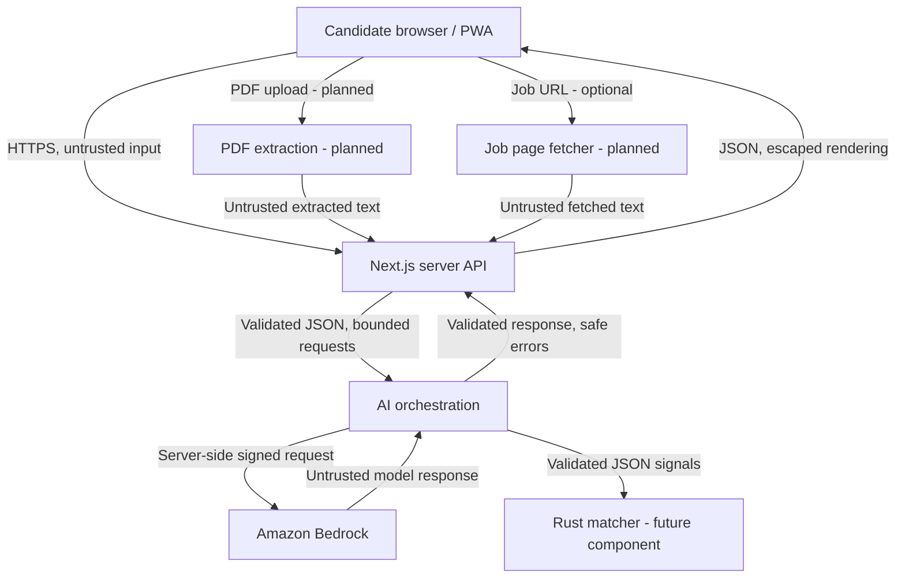

# ScaleMe threat model (living document)

**Version:** draft 0.1 · **Status:** design review, not certification.  
**Scope:** Next.js web/PWA, server-side AI API, AWS Bedrock, future Rust matcher, PDF uploads and job URL ingestion.  
**Frameworks:** [OWASP ASVS 5.0](https://asvs.owasp.org/); [OWASP GenAI LLM Top 10 (current)](https://genai.owasp.org/llm-top-10/).

This document is a required reference for any change that introduces a service, data field, input source, privileged tool, persistence, or external call. **Statuses below mean proposed controls until verified in code and tests.**

## Security goals

1. Protect private candidate data, interview history, credentials and service logs.
2. Prevent untrusted resume/job text from affecting system instructions, permissions or server actions.
3. Avoid false, unsupported career advice and prevent applicant cross-session leaks.
4. Contain cloud usage/cost and deny untrusted network access.
5. Preserve reproducible, reviewable builds and protect code integrity.

## System sketch

The diagram is **architectural intent**. A direct Bedrock integration and mocked tests are currently being developed separately; do not infer deployment, storage or security controls exist solely from this drawing.

## Trust boundaries and assets

| Boundary | Attacker-controlled surface | Protected asset |
| --- | --- | --- |
| Browser → API | JSON, query strings, headers, cookies, file names, size | Cloud spend, server process, candidate data |
| PDF → parser → API | Embedded text, malformed PDFs, metadata | Availability, filesystem, prompt integrity |
| Job URL → fetcher → API | URL, redirects, DNS, server responses, embedded instructions | Internal network/AWS metadata service, backend secrets |
| API → Bedrock → API | Context/data sent to provider, model-generated JSON | Applicant privacy, decision correctness, cost |
| Server → Rust | Untrusted JSON/arguments and executable packaging | Process control, integrity and stability |
| CI / contributor → Git | Malicious or vulnerable packages, prompt-injected files, credentials | Repository integrity and workflow tokens |
| Future persistence / accounts | Stored records, session identifiers | Cross-user confidentiality and authorized access |

## Prioritized threats and planned defenses

**High** = address before a public/unauthenticated launch. **Medium** = investigate/test as part of MVP or before using real data. The priorities are project-level engineering judgments, not measured risk scores.

| Threat | Priority | Required control | How to verify | Current known state |
| --- | --- | --- | --- | --- |
| **LLM prompt injection** in resume, job text, or fetched pages | High | Separate system instruction from untrusted content; prevent AI-initiated actions; validate evidence and schema; reject tool/secret requests | Adversarial synthetic inputs against real configured model and response validation | Implemented (Issue #6, merged in PR #33): system prompt + randomized data tags, no model tools, schema and evidence checks. Verified by **mocked** tests only; **live model resistance unverified** |
| **Sensitive information disclosure** via logs, model response, history or cross-user access | High | Data minimization; no raw request logging; private-by-default sessions; no secrets in prompts; retention policy | Code inspection, seeded PII canaries, negative tests, session boundary tests | The fit route (PR #33) logs only error type names, HTTP status and fixed configuration hints, never request, resume or model text (checked by mocked tests and self-review; **not independently reviewed**). Full resume/job text is sent to Bedrock (see data flow below). Storage not designed; none exists |
| **Unbounded inference/cost** (public API abuse, large loops) | High | Per-client limits, concurrency caps, body/turn caps, timeouts, output-token caps, AWS budgets/alarms | Burst/concurrency and huge-input tests; AWS cost monitoring | Body/field caps (200 KB streamed, per-field limits), 45 s timeout and 3000 output-token cap (Issue #6). Issue #23: live calls **off by default** (`FIT_LIVE_AI_ENABLED`), one shared in-process budget of 10/min, 50/day and 2 concurrent calls, `429` before any AWS call, AWS SDK `maxAttempts` 1. Mock-tested only. **Per-process, not distributed, no per-user fairness**; owner-reported $5 budget notification and $20 spending limit are unverified and not a hard cap, so the route is still **not safe to expose publicly** (see "Cost guard" below) |
| **SSRF** through user-provided job URLs | High | HTTPS/allowed host policy, strict DNS/IP validation at each fetch/redirect, deny private/loopback/link-local/metadata targets, response byte/time caps | Safe blocked-URL unit tests including 127.0.0.1, link-local, redirects, DNS rebinding edge cases | Job ingestion is planned/assigned; not verified |
| **Malicious PDF / parser denial of service** | High | MIME+magic inspection, maximum size/pages, parser time/memory limits, no executable conversions, isolated parsing where viable | Invalid, corrupt, image-only, oversized and complex PDF tests | Resume parser assigned, not verified |
| **Model output injection / unsafe rendering** | High | Runtime response schemas, escape text, no direct HTML injection or executing output | HTML/script payload test, oversized/malformed JSON, no `dangerouslySetInnerHTML` | Zod validation, JSON extraction and evidence checks implemented (PR #33) and mock-tested; unknown extra keys are stripped. Model-written prose fields are length-checked, not fact-checked. UI integration unknown (frontend must render as escaped text) |
| **Cloud key leak / overprivileged role** | High | SDK default credential chain server-only; least-privilege IAM, secrets rotation, no client-accessible credentials | Inspect env usage, bundle, IAM role and logs, secret scanning | Design documented; AWS account configuration not verified |
| **Dependency or CI supply-chain compromise** | Medium | Lockfiles, Dependabot, npm audit, human review, read-only workflow tokens | CI logs, dependency changes, action review | CI exists. 2026-11-14 on `main` after the ESLint 10 bump (#29), rechecked for Issue #23: `npm audit --omit=dev` reports **0** (production); full `npm audit` reports **9 moderate**, 0 high/critical, all from `minimatch` in the ESLint/`typescript-eslint` dev toolchain (`npm audit --audit-level=high` exits 0). Not changed here; update deliberately, no forced fixes. Issue #23 adds no dependencies. New runtime deps: `@aws-sdk/client-bedrock-runtime`, `zod`; new dev dep: `vitest@4` |
| **Fabricated claims / false eligibility guidance** | Medium | Quote-grounded evidence, unknown != ineligible, human-verifiable outputs, clear disclaimer | Test ungrounded metrics and visa/sponsorship statements | Evidence quotes are checked as substrings of the input; `supported` without a verified resume quote is downgraded. Substring matching does not prove the quote supports the claim, and model explanations are not fact-checked. Employer guidance is future scope |
| **False provenance / inflated documented coverage** | Medium | Candidate-only source IDs, exact quote validation, stable requirement ID denominator, deterministic counting and human review states | Missing/irrelevant answers, spoofed evidence links, job text masquerading as candidate evidence, invented numeric claims | Evidence ledger and before/after coverage are proposed; not implemented or verified |
| **CSRF/CORS/auth errors** after accounts or cross-origin API clients | High once applicable | Explicit identity/authorization design, session binding, origin/CSRF checks, access control | Cross-user, wrong-origin, privilege escalation tests | No accounts planned in first MVP; revisit with auth or Expo client |

## Issue #6 fit-analysis implementation (merged to `main` in PR #33)

Status: merged to `main` in PR #33 after self-review by the implementing agent; it is **not** independently audited and the ScaleMe API has **not** been tested against live Bedrock (the owner reports only an AWS console-playground test of Amazon Nova Lite in `us-east-2`). Its tests are **mocked**. Details: [BEDROCK_REVIEW_NOTES.md](BEDROCK_REVIEW_NOTES.md) and [api-contract.md](../api-contract.md).

**Data flow introduced:** the candidate's full resume text and the job title, company and text leave the Next.js server for Amazon Bedrock in the configured `AWS_REGION` on every live call. This is the first flow of personal data to an external provider. Not yet documented or verified: Bedrock's data retention/logging settings for the chosen model, regional processing, and user disclosure/consent. Use synthetic data only until they are. Fields `filename`, `sourceUrl` and `sections` are accepted by the API but **not** sent. Nothing is stored; the response goes back to the caller only.

**Trust boundaries touched:** Browser → API (validated JSON); API → Bedrock (server-side SDK credentials, no tools or network access given to the model); Bedrock → API (untrusted model text, parsed as JSON and checked). A new unauthenticated route exists, `POST /api/fit/analyze`, which is cost-bearing when AWS is configured. `?demo=true` is a no-AWS path that ignores the body.

**Controls in code (mock-tested):** field and byte limits (streamed); Zod request and response schemas; per-request random tags around untrusted text with a system prompt that treats it as data; evidence-quote verification; `supported` downgrade; rejection of unsupplied requirement IDs; fixed server disclaimer; AWS errors mapped to fixed safe messages; logs contain error type only.

**Known residual risks:**
- Cost guard is local only (Issue #23, see below). Anyone who can reach a live-enabled server can use up its whole budget. The owner-reported $5 budget notification and $20 spending limit are unverified and are not a hard cap.
- Prompt injection: only the prompt wording, lack of tools, and post-checks mitigate it. A resume could still steer the model's *prose* (summary, explanations, questions, suggestions), which is not fact-checked. Verified only by mocks.
- Short evidence quotes (for example one common word) can match the input by chance.
- No retry or caching (SDK `maxAttempts` 1 by default); one timeout fails the request. Unauthenticated route: no CSRF/CORS/auth design (acceptable only for a private demo).
- Dependence on one model whose JSON compliance is unverified; invalid output returns `INVALID_AI_RESPONSE` (502).

**Important:** A random delimiter/tag in the prompt is not a security boundary. A model can still follow adversarial instructions. Defense-in-depth should rely on **no privileged model tools**, strict outputs, evidence verification and application-side authorization.

## Issue #23 cost guard (2026-11-14)

Status: implemented and **mock-tested only** (fake clock, mocked Bedrock, synthetic data). Not independently reviewed, not load-tested against a running server. Code: `web/src/lib/ai/rate-limit.ts`, `web/src/lib/ai/config.ts`, `web/src/app/api/fit/analyze/route.ts`.

**Controls:**
- **Explicit activation:** live Bedrock calls happen only when `FIT_LIVE_AI_ENABLED` is `true`. Default is off; AWS settings alone no longer enable paid calls.
- **Checks before spending:** body/schema validation, the live switch, and valid cost-guard and AWS settings all run first. Malformed input and misconfiguration never use up the budget or reach AWS. A cost-guard variable that is set but invalid fails closed (503), never "unlimited".
- **One shared anonymous budget:** sliding 60 s window (default 10), sliding 24 h window (default 50), concurrency cap (default 2, rejected rather than queued). An admitted call counts even if Bedrock fails, because it may still be billed. The concurrency slot is released in a `finally` block on every outcome.
- **Safe 429:** `RATE_LIMITED`, `retryable: true`, `Retry-After` header, one generic message that reveals neither the limit type nor its values.
- **No hidden retries:** AWS SDK `maxAttempts` 1 by default (the SDK default is 3), configurable to at most 2.
- **No caller tracking:** client IP headers (`X-Forwarded-For`, `X-Real-IP`, `Forwarded`) are deliberately ignored, because any client can forge them; there is no trusted reverse proxy yet. Nothing about the caller is stored. Logs record only the limit type (for example `Rate limited: minute`).
- **No response cache and no merging of identical requests**, by owner decision, to avoid keeping analysis output (which contains resume quotes) in memory.
- **Demo mode** stays free: it is checked first, needs no AWS settings and is not limited.

**Why the endpoint must stay private (limitations):**
- **Per-process only.** Counters live in one Node.js process's memory. Several instances (serverless scaling, multiple containers) each have their own budget, so the real ceiling is the limits multiplied by the instance count. A restart, redeploy or cold start resets the counters. This is acceptable for one local or private `next start` process, **not** as a production limit.
- **No per-user fairness.** Without trusted client identity, one caller can use up the shared budget and block everyone else (denial of service), though not exceed the cost ceiling of that process.
- **Not an AWS-side control.** The guard cannot stop calls made with the same credentials outside this app, and it is not a spending alarm.
- **AWS spend controls are unverified and soft.** an AWS budget notification at **$5** has been configured and a **$20** project spending limit has been selected. Neither is a guaranteed account-wide hard cap: a budget notification is an alert, not a stop, billing data can lag actual usage, and other usage in the account is not blocked. Treat them as early warnings on top of the app-side cost guard, not as a replacement for it.
- **Unauthenticated route.** No auth, CORS or CSRF design.

**Required before any public exposure (not provisioned; each needs owner approval):** an enforcement point shared by all instances (API Gateway usage plan or AWS WAF rate-based rule in front of the app, or a shared counter store such as Redis or DynamoDB behind the limiter), trusted client identity (authenticated users, or a trusted proxy whose client-IP header is the only one honored), verification of the owner-reported AWS budget notification (an alert, not a hard cap), a review of Bedrock service quotas for the chosen model, and least-privilege IAM limited to that model.

## Review triggers

Update this file whenever an agent changes:
- External service/model provider, prompt contents, tool permissions, inference settings, pricing or rate limits.
- What applicant data is collected, processed, logged, retained, shared or persisted.
- Upload parser, job URL fetching behavior or network egress.
- Authorization, sessions, user identity, public hosting, API routing or storage.
- Dependency trust, CI privileges, or cloud IAM.

Capture the change in the same PR and add corresponding tests to [Review Checklist](REVIEW_CHECKLIST.md). A reviewer signs off on new high risks **before** public exposure.

## Tracking high-priority security work

- [#23 — Rate-limit and cost-protect Bedrock endpoints](https://github.com/charlierichards13/ScaleMe/issues/23)
- [#24 — Adversarial AI/privacy review](https://github.com/charlierichards13/ScaleMe/issues/24)
- [#4 — Safe resume PDF parsing](https://github.com/charlierichards13/ScaleMe/issues/4)
- [#5 — Safe pasted job and URL ingestion](https://github.com/charlierichards13/ScaleMe/issues/5)

## Open decisions (human-owned)

- How will abuse limits be enforced across deployment instances (shared store vs trusted gateway)? Today: in-process only (Issue #23), which is not sufficient for public exposure.
- Which Bedrock model, region, retention options and least-privilege resource ARN are actually permitted in the AWS account? Owner reports `us-east-2` access with Amazon Nova Lite working in the console playground; the ScaleMe model ID, retention settings and IAM resource ARN are not yet decided or verified.
- Is the prototype available to the public, or kept local/private using only synthetic data?
- Are interview histories persisted? If so, how are records encrypted, authorized and deleted?
- Where does the Rust matcher execute in hosted environments without arbitrary executable support?
- Will job URL retrieval be restricted to a documented allowlist or delegated to a trusted provider?

Record answers as dated decisions in this file. No agents should silently make these policy decisions.
